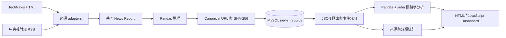

# Morning Alpha v0.2 Alpha

Morning Alpha 是一個繁體中文科技與財經新聞分析學習專案。它把分散的新聞收集、資料整理、MySQL 儲存、統計分析與 Dashboard 閱讀整合成一條可以重複執行的 Pipeline。

使用者執行一個命令後，可以在同一個 Dashboard：

- 閱讀 TechNews 與中央社財經新聞。
- 搜尋標題，並依來源或分析分類篩選。
- 查看來源分布、主題分布與熱門中文關鍵字。
- 查看標題與時間相近的同事件新聞，同時保留每個來源的文章。
- 透過 canonical URL 避免同一網址被重複寫入。

Morning Alpha 是資料工程與全端資料流程的練習專案，不是投資建議系統。

## v0.2 Alpha 已實作功能

### 資料收集

- TechNews HTML adapter：每次解析首頁最多 5 篇文章。
- 中央社財經 RSS adapter：只接受中央社產經證券 `/news/afe/` 分類。
- 不同來源會轉成共同 News Record 格式。
- HTTP request 最多嘗試 3 次，並記錄成功、retry 與錯誤。
- 網站必要結構缺失或沒有可用文章時，Pipeline 會停止並回報異常。

### 資料品質與 MySQL

- 正式保存 `source`、`source_category` 與 `analysis_category`。
- 保留原始 URL，另外產生 canonical URL。
- canonical URL 會轉成 SHA-256 hash，由 MySQL UNIQUE index 防止重複。
- 標題不再是 UNIQUE；不同網址即使標題相同仍可保存。
- 提供依序檢查與套用 001～004 schema migrations 的 Python runner。
- Pandas 缺值會轉成 Python `None`，安全寫成 MySQL `NULL`。

### 分析與 Dashboard

- 使用 `jieba-py` 進行繁體中文斷詞。
- 使用 Pandas 計算 Top 20 關鍵字；Dashboard 顯示相同結果的前 10 名。
- 依來源與分析分類產生圖表統計。
- 以 72 小時、共同關鍵字與 Jaccard similarity 進行保守的事件分組。
- Dashboard 支援搜尋、來源篩選、分類篩選、排序、分頁與同事件篩選。
- 顯示資料最後更新時間。

### 測試

- 每個主要模組都有獨立 `unittest`。
- Crawler parser 使用固定 HTML／XML fixtures，不依賴即時網站內容。
- Dashboard 具有 JSON 與互動功能的 contract tests。

## 系統流程



日常更新只需要執行：

```bash
python src/run_pipeline.py
```

Pipeline 依序完成：

1. 下載並解析所有新聞來源。
2. 使用 Pandas 整理後寫入 MySQL。
3. 匯出新聞與資料更新時間。
4. 產生圖表與 Top 20 關鍵字 JSON。

## 技術

- Python、Requests、BeautifulSoup
- Pandas、jieba-py
- MySQL、PyMySQL
- HTML、CSS、JavaScript
- Chart.js 4.5.1
- Git、Python `unittest`

Dashboard 沒有使用 DataTables，也沒有 web backend；搜尋、篩選、排序與分頁由原生 JavaScript 完成。

## 專案結構

```text
Morning-Alpha/
├── src/
│   ├── run_pipeline.py          # 日常資料更新入口
│   ├── run_migrations.py        # 檢查／套用既有 database migrations
│   ├── api.py                   # MySQL-backed Flask API
│   ├── news_sources.py          # 集中啟用所有 adapters
│   ├── technews_adapter.py
│   ├── cna_finance_adapter.py
│   ├── store_news.py            # MySQL 寫入與最新 schema
│   ├── export_news_json.py
│   ├── analyze_keywords.py
│   └── event_grouping.py
├── sql/                         # 001～004 migrations
├── data/
│   ├── raw/                     # jieba 自訂詞典
│   └── processed/               # runtime log 與稽核報告
├── dashboard/
│   ├── index.html
│   ├── styles.css
│   ├── app.js
│   ├── news.json
│   ├── chart_data.json
│   ├── keyword.json
│   └── metadata.json
├── tests/
│   └── fixtures/                # 固定 crawler 測試資料
├── docs/
│   └── USER_GUIDE.md
└── requirements.txt
```

完整檔案說明、Database schema、SQL 範例與疑難排解請閱讀 [Morning Alpha 使用手冊](docs/USER_GUIDE.md)。

## 系統需求

- Python 3.10 以上
- MySQL（repository 未鎖定版本；開發說明以 Homebrew MySQL 8.4 為例）
- 支援 JavaScript、`fetch()` 與 canvas 的現代瀏覽器
- Pipeline 需要連到新聞來源；Dashboard 需要連到 Chart.js CDN

Python packages：

```text
requests
beautifulsoup4
pandas
PyMySQL
jieba-py==0.46.12
```

## 快速安裝

### 1. Clone repository

```bash
git clone https://github.com/OllieHu12304/Morning-Alpha.git
cd Morning-Alpha
```

### 2. 建立虛擬環境

```bash
python3 -m venv .venv
source .venv/bin/activate
python -m pip install -r requirements.txt
```

確認使用 `.venv`，而不是 Anaconda 或系統 Python：

```bash
which python
```

輸出路徑應以專案的 `.venv/bin/python` 結尾。

### 3. 建立 MySQL database 與 app user

先以 MySQL 管理員登入：

```bash
mysql -u root -p
```

```sql
CREATE DATABASE IF NOT EXISTS morning_alpha
CHARACTER SET utf8mb4
COLLATE utf8mb4_unicode_ci;

CREATE USER 'morning_alpha_app'@'localhost'
IDENTIFIED BY '請替換成安全密碼';

GRANT CREATE, INSERT, SELECT
ON morning_alpha.*
TO 'morning_alpha_app'@'localhost';
```

請把真實密碼保存在密碼管理器，不要寫入 repository。

### 4. 建立本機 `.env`

```bash
cp .env.example .env
```

開啟 `.env`，將 `MYSQL_PASSWORD` 替換成真實 app password：

```text
MYSQL_HOST=localhost
MYSQL_PORT=3306
MYSQL_USER=morning_alpha_app
MYSQL_PASSWORD=請替換成真實密碼
MYSQL_DATABASE=morning_alpha
```

`.env` 已由 Git 忽略，不應提交；`.env.example` 只保存欄位範例。Shell environment 與未來 GitHub Secrets 的優先權高於 `.env`。

可用變數與預設值：

| 環境變數 | 預設值 |
| --- | --- |
| `MYSQL_HOST` | `localhost` |
| `MYSQL_PORT` | `3306` |
| `MYSQL_DATABASE` | `morning_alpha` |

`MYSQL_USER` 與 `MYSQL_PASSWORD` 沒有預設值；未建立 `.env` 時仍可沿用原本的 `export` 方式。

## Database migrations

### 全新 database

不需要執行 migration。第一次 Pipeline 會直接建立最新 `news_records` table。

### 從 v0.1 升級的既有 database

先備份，再檢查目前狀態：

```bash
mysqldump -u root -p morning_alpha > ../morning_alpha_before_v0.2.sql
python src/run_migrations.py
```

`run_migrations.py` 預設唯讀。套用 001～004 需要 `ALTER`、`UPDATE` 與 `SELECT` 權限，建議暫時使用 MySQL 管理員 credentials：

```bash
export MYSQL_USER="root"
read -s "MYSQL_PASSWORD?MySQL root password: "
echo
export MYSQL_PASSWORD
python src/run_migrations.py --apply
```

完成後清除管理員 shell credentials，讓程式重新讀取 `.env` 中的 `morning_alpha_app`：

```bash
unset MYSQL_USER MYSQL_PASSWORD
```

再執行日常 Pipeline。

## 執行 Morning Alpha

### 1. 更新資料

請從 repository 根目錄執行：

```bash
./.venv/bin/python src/run_pipeline.py
```

成功時會看到：

```text
Step 1/4：爬取、整理並儲存新聞…
Step 2/4：匯出 Dashboard 新聞資料…
Step 3/4：產生 Dashboard 圖表資料…
Step 4/4：產生 Top 20 關鍵字資料…
Morning Alpha 資料更新完成。
```

實際新增與匯出筆數會依網站與 database 內容不同。

### 2. 啟動 API 與 Dashboard

在另一個 terminal 執行：

```bash
./.venv/bin/python src/api.py
```

開啟 [http://127.0.0.1:5050](http://127.0.0.1:5050)。Flask 會同時提供 Dashboard 與 API，不需要另外啟動 port 8000。使用 5050 是為了避開 macOS AirPlay Receiver 常用的 port 5000。

Dashboard 直接讀取：

- `GET /api/news`：從 MySQL 取得新聞與事件分組。
- `GET /api/analytics`：從 MySQL 計算來源、分類、Top 20 關鍵字與最後新增時間。
- `GET /api/health`：確認 Flask 服務可回應。

Pipeline 目前仍會輸出四個 JSON 作為學習與備援資料，但 Dashboard 已不再依賴它們。API error response 不會包含 MySQL 帳號、密碼或 SQL 細節。

## 執行測試

測試不需要真實 MySQL 或新聞網站：

```bash
./.venv/bin/python -m unittest discover -s tests -v
```

## 常用除錯

```bash
# 確認 interpreter
which python

# 唯讀檢查 migration
./.venv/bin/python src/run_migrations.py

# 查看 retry、排除文章與 crawler 錯誤
tail -n 100 data/processed/morning_alpha.log

# 查看 MySQL 最新 20 筆
./.venv/bin/python src/read_news.py
```

- `ModuleNotFoundError: jieba`：通常是誤用 Anaconda Python；改用 `./.venv/bin/python` 並重新安裝 requirements。
- `Unknown column 'source'`：既有 MySQL table 尚未完成 migrations。
- `nan can not be used with MySQL`：請確認程式包含 v0.2 的 Pandas 空值轉換修正。
- Dashboard `Failed to fetch`：請確認 `src/api.py` 正在執行，並從 port 5050 開啟頁面。

## 目前限制

- 只有 TechNews 與中央社財經兩個來源。
- TechNews 每次只解析首頁最多 5 篇。
- 來源網站改版後仍可能需要修改 adapter selector。
- 任一來源最終下載或解析失敗會停止整條 Pipeline。
- URL UNIQUE 只能防止相同 canonical URL；不同平台的同事件文章只分組、不刪除。
- 事件分組、分析分類與 jieba 關鍵字都是規則式分析，可能漏判或誤判。
- 沒有文章全文、AI 摘要、股票行情、投資評分、使用者帳號或後端 API。
- 沒有自動排程或即時更新。
- 先前已寫入 MySQL 的非財經 CNA 資料不會因新 adapter 白名單自動刪除。

## 下一步

- 安全稽核與清理既有非財經 CNA 資料。
- 讓單一來源失敗時，其他來源仍可繼續更新。
- 加入自動排程與來源健康狀態。
- 持續改善分類、斷詞與事件相似度。

更多操作與面試說明請參考 [docs/USER_GUIDE.md](docs/USER_GUIDE.md)。
