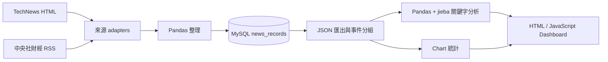

# Morning Alpha v0.1

Morning Alpha 是一個繁體中文科技與財經新聞分析學習專案。它會從 TechNews 與中央社財經 RSS 收集文章，以 Pandas 整理後存進 MySQL，再輸出 JSON 給靜態 Dashboard 顯示。

目前可以完成：

- 一個命令更新新聞、資料庫、JSON 與統計。
- 以 canonical URL 避免同一網址重複寫入；相同標題仍可保留。
- 將不同來源的文章轉成共同格式，分開保存來源分類與分析分類。
- 使用 `jieba-py` 中文斷詞與 Pandas 計算 Top 20 關鍵字。
- 將標題與時間相近的新聞分成同事件，但不刪除原始文章。
- 在 Dashboard 搜尋、依來源／分類篩選、排序、分頁及查看同事件文章。
- 對 HTTP request 執行 retry，並記錄 log；以固定 fixtures 測試 crawler parser。

Morning Alpha v0.1 不是投資建議系統，也沒有即時行情、AI 摘要、使用者帳號、後端 API 或自動排程。

完整教學、資料格式、資料庫 schema 與疑難排解請閱讀 [使用手冊](docs/USER_GUIDE.md)。

## 資料流程



## 需求

- Python 3.10 以上（`jieba-py` 的套件需求）
- MySQL（repository 未鎖定版本；開發說明以 Homebrew MySQL 8.4 為例）
- 現代瀏覽器與網路連線（Chart.js 4.5.1 由 CDN 載入）
- Python packages：Requests、BeautifulSoup、Pandas、PyMySQL、`jieba-py==0.46.12`

## 快速開始

### 1. Clone 與安裝 Python 套件

```bash
git clone https://github.com/OllieHu12304/Morning-Alpha.git
cd Morning-Alpha
python3 -m venv .venv
source .venv/bin/activate
python -m pip install -r requirements.txt
```

啟用 `.venv` 可確保 `python` 使用這個專案安裝的套件，不會誤用 Anaconda 或系統 Python。

### 2. 建立 MySQL database 與專用帳號

先用 MySQL 管理員登入：

```bash
mysql -u root -p
```

```sql
CREATE DATABASE IF NOT EXISTS morning_alpha
CHARACTER SET utf8mb4
COLLATE utf8mb4_unicode_ci;

CREATE USER 'morning_alpha_app'@'localhost'
IDENTIFIED BY '請替換成安全密碼';

GRANT CREATE, INSERT, SELECT
ON morning_alpha.*
TO 'morning_alpha_app'@'localhost';
```

不要把真實密碼寫入 repository。

### 3. 設定目前 terminal 的環境變數

```bash
export MYSQL_USER="morning_alpha_app"
read -s "MYSQL_PASSWORD?MySQL password: "
echo
export MYSQL_PASSWORD
```

選用設定及預設值：

```bash
export MYSQL_HOST="localhost"
export MYSQL_PORT="3306"
export MYSQL_DATABASE="morning_alpha"
```

環境變數只在目前 shell session 有效。開新 terminal 後需重新設定。

### 4. 既有 database 才需套用 migrations

全新 database 不需要 migration；Pipeline 會建立最新 table。既有 `news_records` 可先唯讀檢查：

```bash
python src/run_migrations.py
```

套用 migration 需要 `ALTER`、`UPDATE`、`SELECT` 權限，建議先備份，再暫時以管理員 credentials 執行：

```bash
mysqldump -u root -p morning_alpha > ../morning_alpha_before_upgrade.sql
export MYSQL_USER="root"
read -s "MYSQL_PASSWORD?MySQL root password: "
echo
export MYSQL_PASSWORD
python src/run_migrations.py --apply
```

完成後，重新設定 `MYSQL_USER` 與 `MYSQL_PASSWORD` 為 `morning_alpha_app`。不要逐一手動重跑已完成的 SQL。

### 5. 執行完整 Pipeline

從 repository 根目錄執行：

```bash
python src/run_pipeline.py
```

它會依序：

1. 下載 TechNews HTML 與中央社財經 RSS、解析並整理文章。
2. 寫入 MySQL；canonical URL hash 已存在的文章由 `INSERT IGNORE` 跳過。
3. 匯出 `news.json`、事件分組與 `metadata.json`。
4. 產生 `chart_data.json` 與 Top 20 `keyword.json`。

### 6. 啟動 Dashboard

不要直接雙擊 `index.html`，因為瀏覽器通常會阻擋 `file://` 載入 JSON。在另一個 terminal 執行：

```bash
python -m http.server 8000 --directory dashboard
```

開啟 [http://localhost:8000](http://localhost:8000)。Dashboard 會讀取：

- `dashboard/news.json`
- `dashboard/chart_data.json`
- `dashboard/keyword.json`
- `dashboard/metadata.json`

## 專案結構摘要

```text
Morning-Alpha/
├── src/                 # crawler adapters、資料整理、MySQL、分析與 pipeline
├── sql/                 # 001～004 既有 database migrations
├── data/raw/            # jieba 自訂詞典
├── data/processed/      # runtime log／稽核報告（不應提交）
├── dashboard/           # HTML、CSS、JavaScript 與產生的 JSON
├── tests/               # 單元、crawler fixtures、Dashboard contract tests
├── docs/USER_GUIDE.md   # 完整使用手冊
└── requirements.txt
```

## 測試

測試不需要連到新聞網站或真實 MySQL：

```bash
python -m unittest discover -s tests -v
```

Crawler tests 使用 `tests/fixtures/` 的固定 HTML／XML，因此網站內容變動不會讓 parser 測試結果飄動。真實網站仍可能改版，所以正式 Pipeline 另外具有空結果／結構異常偵測。

## 常用除錯命令

```bash
# 確認目前使用的 Python
which python
python --version

# 唯讀檢查 migration 狀態
python src/run_migrations.py

# 查看 crawler retry 與錯誤 log
tail -n 50 data/processed/morning_alpha.log

# 查看 MySQL 最新資料
python src/read_news.py
```

若 Pipeline 出現 `Unknown column 'source'`，代表既有 table 尚未完成 migrations；不要修改 Python 欄位名稱，請依上方 migration 流程升級 schema。
