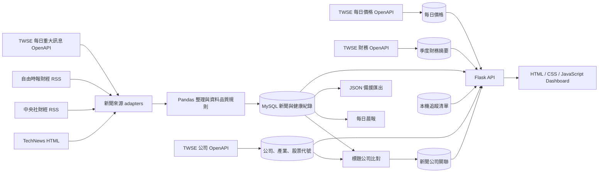

# Morning Alpha

Morning Alpha 是一個繁體中文科技與財經資訊整理學習專案。它用一條可重複執行的 Pipeline 收集新聞、整理資料、建立公司關聯、同步 TWSE 市場／財務資料、產生每日晨報，再由 Flask API 提供給 JavaScript Dashboard。

本專案目前已完成第一至第四階段的功能開發，接下來進入 end-to-end 除錯與驗收。內容只供資料整理與程式學習，不構成投資建議。

## 使用者可以做什麼

- 閱讀 TechNews、中央社財經、自由時報財經與 TWSE 上市公司官方重大訊息。
- 搜尋、排序、分頁，並依來源、分析分類、公司或同事件篩選新聞。
- 查看來源、分類與中文斷詞關鍵字統計。
- 查看資料來源健康狀態與最近 Pipeline 執行紀錄。
- 閱讀固定 07:00（Asia/Taipei）時間窗產生的每日晨報。
- 查看規則式標題比對出的公司、產業與股票代號。
- 查看 TWSE 官方每日盤後價格與季度財務摘要。
- 觀察公司新聞前後交易日的價格變化；介面明確標示為時間關聯，不宣稱因果。
- 以股票代號或公司名稱搜尋、加入／移除追蹤公司，閱讀只包含追蹤公司相關新聞的個人化晨報。

## 重要限制

- 媒體新聞目前有 TechNews、中央社財經與自由時報財經；TWSE 來源是每日官方重大訊息，不等同媒體報導，也不含公告全文。
- TechNews 每次最多解析首頁 5 篇；中央社另以 URL 與彩券標題規則排除非目標文章；自由時報使用官方財經 RSS。
- [自由時報官方 RSS](https://service.ltn.com.tw/RSS) 僅在目前個人、非商業用途下使用並標示出處；若改為商業用途，必須重新確認授權。
- 新聞摘要只使用標題與結構化欄位，沒有讀取文章全文，也不是 AI 摘要。
- 公司辨識、分類、事件分組及關鍵字分析都是規則式方法，可能漏判或誤判。
- 市場價格是 TWSE 每日盤後資料，不是即時行情；財務資料不是完整財報。
- 新聞與市場變化只呈現時間關聯，不能用來證明新聞造成價格變動。
- 追蹤清單是單一 MySQL database 內的本機清單，沒有帳號、登入或多使用者隔離。
- Flask API 沒有 authentication，不應直接公開到 Internet。
- Docker scheduler 是本機間隔排程；Mac 關機或 Docker 停止時不會執行。

## 系統流程



## 九步統一 Pipeline

從 repository 根目錄執行：

```bash
./.venv/bin/python src/run_pipeline.py
```

Pipeline 依序執行：

1. 爬取、整理並儲存新聞。
2. 同步 TWSE 公司資料，並確保追蹤清單 table 存在。
3. 依新聞標題建立新聞公司關聯。
4. 同步 TWSE 每日盤後價格。
5. 同步 TWSE 季度財務摘要。
6. 產生並保存每日晨報。
7. 匯出 `dashboard/news.json` 與 `metadata.json`。
8. 產生 `dashboard/chart_data.json`。
9. 產生 Top 20 `dashboard/keyword.json`。

Dashboard 目前直接讀取 Flask API 與 MySQL；JSON 是學習、檢查與備援輸出，不是 Dashboard 的主要資料來源。新版 Pipeline history 保存九步結果，API 仍可讀取舊版四步歷史。

API 啟動後，也可以在 Dashboard 的「Pipeline 執行紀錄」區按下「立即更新資料」。Pipeline 會在同一個 Python 與 MySQL 環境中背景執行，執行期間按鈕會鎖定，成功後頁面會自動重新載入最新資料。

新聞身分中，`source` 代表 Morning Alpha 實際使用的 adapter／取得管道，`publisher` 代表原始發布媒體。直接來源兩者通常相同；未來聚合來源則可能不同。`source_article_id` 與 canonical URL 共同阻止確定的重複匯入，相似新聞仍只分組、不刪除。

## 技術

- Python 3.13
- Requests 2.34.2、BeautifulSoup 4.15.0
- Pandas 3.0.5、jieba-py 0.46.12
- MySQL 8.4、PyMySQL 1.2.0
- Flask 3.1.3
- HTML、CSS、原生 JavaScript、Chart.js 4.5.1
- Python `unittest`、Playwright 1.62.1
- Docker、Docker Compose、GitHub Actions

Dashboard 沒有使用 DataTables；搜尋、篩選、排序與分頁由原生 JavaScript 實作。

## 建議日常方式：原生環境

若 Mac 儲存空間有限，建議日常開發使用 `.venv` 與本機 MySQL。這個方式不會建立 Docker images 或 build cache；完整安裝步驟請見下方「快速開始：原生環境」。

日常只需要執行：

```bash
python3 start.py
```

啟動器會自動使用專案 `.venv`、啟動 API、等待 5050 就緒並開啟瀏覽器。進入 Dashboard 後，按「立即更新資料」即可執行完整 Pipeline；按 `Control + C` 可停止 API。

Docker 主要用於第一次快速安裝、跨電腦重現環境與 CI 驗證，不是每次更新資料前都必須執行的步驟。

## 選用方式：Docker

Docker 方式不需要另外安裝 Python 或 MySQL。

```bash
git clone https://github.com/OllieHu12304/Morning-Alpha.git
cd Morning-Alpha
cp .env.example .env
```

編輯 `.env`，把 `MYSQL_PASSWORD` 換成這份 Docker database 專用的新密碼。它不是 Mac 登入密碼：

```text
MYSQL_USER=morning_alpha_app
MYSQL_PASSWORD=請換成至少 20 個字元的新密碼
MYSQL_DATABASE=morning_alpha
```

接著執行：

```bash
docker compose build api
docker compose up -d db
docker compose run --rm api python src/run_pipeline.py
docker compose up -d api
```

開啟 [http://127.0.0.1:5050](http://127.0.0.1:5050)。資料保存在 `mysql-data` named volume；`docker compose down` 會保留資料，`docker compose down -v` 會刪除整個 volume，請勿誤用。

`docker compose build api` 只需在第一次安裝，或 `Dockerfile`、Python packages、應用程式程式碼改變後執行。單純更新新聞時不要重複 build：

```bash
docker compose run --rm api python src/run_pipeline.py
```

查看 Docker 實際空間：

```bash
docker system df -v
docker buildx du
```

只清除未使用的 build cache，並把保留量限制在 300 MB：

```bash
docker buildx prune --max-used-space 300mb
```

這個指令不會刪除 images、containers 或 MySQL volume，但下一次 build 可能需要重新下載或安裝部分內容。不要使用 `docker compose down -v` 或含有 `--volumes` 的 prune 指令，除非已備份並確定要刪除資料庫。

若要啟用本機間隔排程：

```bash
docker compose --profile scheduler up -d api scheduler
docker compose logs -f scheduler
```

## 快速開始：原生環境

需求：Git、Python 3.13、MySQL 8.4，以及現代瀏覽器。

```bash
git clone https://github.com/OllieHu12304/Morning-Alpha.git
cd Morning-Alpha
python3 -m venv .venv
source .venv/bin/activate
python -m pip install -r requirements.txt
cp .env.example .env
```

以 MySQL 管理員建立 database 與應用程式帳號：

```sql
CREATE DATABASE morning_alpha
CHARACTER SET utf8mb4
COLLATE utf8mb4_unicode_ci;

CREATE USER 'morning_alpha_app'@'localhost'
IDENTIFIED BY '請換成安全密碼';

GRANT CREATE, ALTER, INDEX, REFERENCES, SELECT, INSERT, UPDATE, DELETE
ON morning_alpha.*
TO 'morning_alpha_app'@'localhost';
```

將同一組 app user 與密碼填入 `.env`。不要填 Mac 密碼，也不要 commit `.env`。

既有 database 先備份，再套用最新 Migration 013：

```bash
./.venv/bin/python src/run_migrations.py
./.venv/bin/python src/run_migrations.py --apply
```

全新 database 完成設定後，可用一個指令啟動 Morning Alpha：

```bash
python3 start.py
```

瀏覽器會自動開啟 [http://127.0.0.1:5050](http://127.0.0.1:5050)。第一次使用時，在「Pipeline 執行紀錄」按下「立即更新資料」建立所需資料；需要觀察完整終端流程時，仍可直接執行 `./.venv/bin/python src/run_pipeline.py`。

## API

| Method | 路徑 | 用途 |
| --- | --- | --- |
| GET | `/api/health` | 確認 Flask 回應 |
| GET | `/api/news` | 新聞、事件分組與相關公司 |
| GET | `/api/analytics` | 來源、分類、關鍵字與更新時間 |
| GET | `/api/source-health` | 來源最近成功／失敗狀態 |
| GET | `/api/pipeline-runs` | 最近十次 Pipeline |
| GET | `/api/pipeline/status` | Dashboard 啟動的 Pipeline 狀態 |
| POST | `/api/pipeline/run` | 從 Dashboard 啟動完整 Pipeline |
| GET | `/api/daily-briefs/latest` | 最新每日晨報 |
| GET | `/api/market-companies` | 有市場／財務資料的公司 |
| GET | `/api/companies/<id>/market-prices` | 最近 90 筆每日價格 |
| GET | `/api/companies/<id>/financial-metrics` | 最近 8 季財務摘要 |
| GET | `/api/event-market-observations` | 非因果的事件價格觀察 |
| GET | `/api/watchlist` | 讀取本機追蹤清單 |
| POST | `/api/watchlist/<id>` | 加入追蹤公司 |
| DELETE | `/api/watchlist/<id>` | 移除追蹤公司 |
| GET | `/api/personalized-brief` | 最新追蹤公司晨報 |

## 測試

一般 Python tests 不連正式 MySQL 或即時網站：

```bash
./.venv/bin/python -m unittest discover -s tests -p "test_*.py" -v
```

Playwright：

```bash
npm ci
npx playwright install chromium
npm run test:e2e
```

MySQL integration tests 只接受 `morning_alpha_test`，需另外設定 `.env` 的 `MYSQL_TEST_*`：

```bash
RUN_MYSQL_INTEGRATION=1 \
./.venv/bin/python -m unittest tests/test_mysql_integration.py -v
```

GitHub Actions 會在自己的 MySQL service 執行 Python、MySQL integration 與 Playwright tests，不會連進使用者 Mac 的 localhost。

## 常用除錯

- `ModuleNotFoundError`：確認使用 `./.venv/bin/python`，再執行 `./.venv/bin/python -m pip install -r requirements.txt`。
- `Access denied`：`.env` 帳號／密碼必須與 MySQL 實際建立的 app user 相同。
- `Unknown column` 或缺少 `watchlist_items`：備份後執行 `src/run_migrations.py --apply`，再重跑 Pipeline。
- `Failed to fetch`：先執行 `src/api.py`，並從 `http://127.0.0.1:5050` 開啟 Dashboard；不要直接雙擊 HTML。
- 外部來源 timeout／503：查看 `data/processed/morning_alpha.log`；單一新聞來源失敗可繼續，但 TWSE 同步屬九步 Pipeline 必要步驟，失敗時會明確停止。

完整架構、Database schema、執行範例與面試學習摘要請閱讀 [docs/USER_GUIDE.md](docs/USER_GUIDE.md)。
