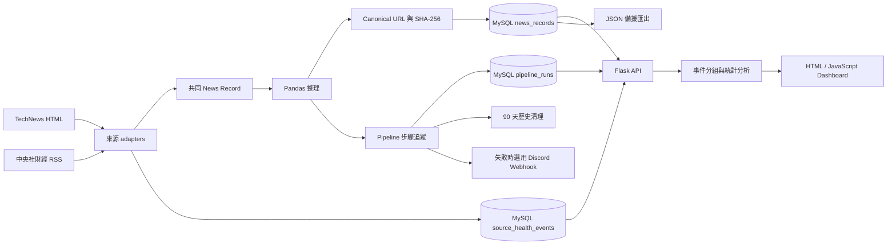

# Morning Alpha v0.2 Alpha

Morning Alpha 是一個繁體中文科技與財經新聞分析學習專案。它把分散的新聞收集、資料整理、MySQL 儲存、統計分析與 Dashboard 閱讀整合成一條可以重複執行的 Pipeline。

使用者執行一個命令後，可以在同一個 Dashboard：

- 閱讀 TechNews 與中央社財經新聞。
- 搜尋標題，並依來源或分析分類篩選。
- 查看來源分布、主題分布與熱門中文關鍵字。
- 查看每個新聞來源最近一次擷取是否成功，以及最近成功時間。
- 查看最近五次完整 Pipeline 的成功／失敗、耗時與四步驟狀態。
- 查看標題與時間相近的同事件新聞，同時保留每個來源的文章。
- 透過 canonical URL 避免同一網址被重複寫入。

Morning Alpha 是資料工程與全端資料流程的練習專案，不是投資建議系統。

## v0.2 Alpha 已實作功能

### 資料收集

- TechNews HTML adapter：每次解析首頁最多 5 篇文章。
- 中央社財經 RSS adapter：只接受中央社產經證券 `/news/afe/` 分類。
- 不同來源會轉成共同 News Record 格式。
- HTTP request 最多嘗試 3 次，並記錄成功、retry 與錯誤。
- 單一來源下載或結構異常時，其他來源仍會繼續；所有來源都失敗時 Pipeline 才停止。
- 每次來源擷取結果都會寫入 `source_health_events`，保留文章數與簡化後的錯誤訊息。

### 資料品質與 MySQL

- 正式保存 `source`、`source_category` 與 `analysis_category`。
- 保留原始 URL，另外產生 canonical URL。
- canonical URL 會轉成 SHA-256 hash，由 MySQL UNIQUE index 防止重複。
- 標題不再是 UNIQUE；不同網址即使標題相同仍可保存。
- 每次完成或可處理的失敗 Pipeline 都會寫入 `pipeline_runs`，包含四步驟 JSON 摘要。
- 來源與 Pipeline 歷史預設保留 90 天，完成執行後自動清理過期紀錄。
- 可選擇設定 Discord Webhook，在 Pipeline 失敗時收到一次安全化通知。
- 提供依序檢查與套用 001～006 schema migrations 的 Python runner。
- Pandas 缺值會轉成 Python `None`，安全寫成 MySQL `NULL`。

### 分析與 Dashboard

- 使用 `jieba-py` 進行繁體中文斷詞。
- 使用 Pandas 計算 Top 20 關鍵字；Dashboard 顯示相同結果的前 10 名。
- 依來源與分析分類產生圖表統計。
- 以 72 小時、共同關鍵字與 Jaccard similarity 進行保守的事件分組。
- Dashboard 支援搜尋、來源篩選、分類篩選、排序、分頁與同事件篩選。
- Dashboard 以狀態卡顯示各來源最近嘗試、最近成功、本次文章數與失敗原因。
- Dashboard 顯示最近五次 Pipeline 執行紀錄、總耗時與各步驟狀態。
- 顯示資料最後更新時間。

### 測試

- 每個主要模組都有獨立 `unittest`。
- Crawler parser 使用固定 HTML／XML fixtures，不依賴即時網站內容。
- Dashboard 具有 JSON 與互動功能的 contract tests。
- MySQL integration tests 使用獨立測試 database。
- Playwright tests 驗證 Dashboard 載入、搜尋、篩選與分頁。
- GitHub Actions 會自動執行 Python、MySQL integration 與 Playwright tests。

## 系統流程



原生環境的日常更新只需要執行：

```bash
python src/run_pipeline.py
```

Pipeline 依序完成：

1. 下載並解析所有新聞來源。
2. 使用 Pandas 整理後寫入 MySQL。
3. 匯出新聞與資料更新時間。
4. 產生圖表與 Top 20 關鍵字 JSON。
5. 將整體成功／失敗、耗時與四步驟摘要保存到 MySQL。
6. 清理超過保留期限的執行歷史；失敗時選擇性傳送 Discord 通知。

## 技術

- Python、Requests、BeautifulSoup
- Pandas、jieba-py
- MySQL、PyMySQL
- HTML、CSS、JavaScript
- Chart.js 4.5.1
- Flask、Playwright
- Docker、Docker Compose
- Git、GitHub Actions、Python `unittest`

Dashboard 沒有使用 DataTables；搜尋、篩選、排序與分頁由原生 JavaScript 完成，新聞與統計資料由 Flask API 提供。

## 專案結構

```text
Morning-Alpha/
├── .github/workflows/ci.yml     # 自動執行三組測試的 CI
├── Dockerfile                   # Morning Alpha Python image
├── compose.yaml                 # API、MySQL、scheduler 與持久化 volume
├── .dockerignore                # 排除不需放進 image 的本機檔案
├── src/
│   ├── run_pipeline.py          # 日常資料更新入口
│   ├── scheduler.py             # 選用的本機間隔排程
│   ├── run_migrations.py        # 檢查／套用既有 database migrations
│   ├── api.py                   # MySQL-backed Flask API
│   ├── source_health.py         # 保存並整理來源擷取健康紀錄
│   ├── pipeline_history.py      # 保存並整理完整 Pipeline 執行紀錄
│   ├── history_retention.py     # 清理超過保留期限的歷史紀錄
│   ├── failure_notification.py  # 選用的 Discord 失敗通知
│   ├── news_sources.py          # 集中啟用所有 adapters
│   ├── technews_adapter.py
│   ├── cna_finance_adapter.py
│   ├── store_news.py            # MySQL 寫入與最新 schema
│   ├── export_news_json.py
│   ├── analyze_keywords.py
│   └── event_grouping.py
├── sql/                         # 001～006 migrations
├── data/
│   ├── raw/                     # jieba 自訂詞典
│   └── processed/               # runtime log 與稽核報告
├── dashboard/
│   ├── index.html
│   ├── styles.css
│   ├── app.js
│   └── *.json                   # Pipeline 產生的備援檔案，Git 忽略
├── tests/
│   └── fixtures/                # 固定 crawler 測試資料
├── docs/
│   └── USER_GUIDE.md
├── package.json                 # Playwright 指令與版本
└── requirements.txt             # 固定 Python package 版本
```

完整檔案說明、Database schema、SQL 範例與疑難排解請閱讀 [Morning Alpha 使用手冊](docs/USER_GUIDE.md)。

## 系統需求

建議初次使用者選擇下列其中一種方式，不要同時混用：

- Docker 方式：Git、Docker Desktop、現代瀏覽器。
- 原生方式：Git、Python 3.13、MySQL 8.4、Node.js（只有 Playwright tests 需要）。

- Pipeline 需要連到新聞來源；Dashboard 需要連到 Chart.js CDN

Python packages 已在 `requirements.txt` 固定版本，包括：

```text
requests
beautifulsoup4
pandas
PyMySQL
jieba-py
python-dotenv
Flask
```

## Docker 快速開始（建議）

Docker 方式不需要另外安裝 Python、建立 `.venv` 或安裝 Homebrew MySQL。每份 clone 都會使用自己的 MySQL container 與 named volume，不會連接 repository 作者的 database。

### 1. Clone repository

```bash
git clone https://github.com/OllieHu12304/Morning-Alpha.git
cd Morning-Alpha
```

### 2. 建立本機 `.env`

```bash
cp .env.example .env
nano .env
```

將 `MYSQL_PASSWORD` 改成這份 Docker database 專用的新密碼：

```text
MYSQL_USER=morning_alpha_app
MYSQL_PASSWORD=請替換成至少 20 個字元的本機密碼
MYSQL_DATABASE=morning_alpha
HISTORY_RETENTION_DAYS=90
PIPELINE_FAILURE_WEBHOOK_URL=
```

這不是 Mac 登入密碼，也不需要沿用 Homebrew MySQL 密碼。Compose 會把 API container 的 `MYSQL_HOST` 設為 `db`，因此 `.env` 中的 `MYSQL_HOST=localhost` 不需修改。

`.env` 已由 Git 忽略，不可 commit。MySQL volume 第一次建立後，單純修改 `.env` 不會改變既有 database user 密碼。

### 3. 建置 API image

```bash
docker compose build api
```

這一步會下載 Python 3.13 slim image、安裝固定版本的 Python packages，並建立 Morning Alpha API image。只有修改 Python 程式或 `requirements.txt` 後才需要重新 build。

### 4. 啟動 MySQL

```bash
docker compose up -d db
docker compose ps
```

等待 `db` 顯示 `healthy`。MySQL 不會占用 Mac 的 port 3306；API 透過 Docker 內部網路使用主機名稱 `db` 連線。

### 5. 第一次執行 Pipeline

```bash
docker compose run --rm api python src/run_pipeline.py
```

第一次 Pipeline 會建立最新 `news_records`、`source_health_events` 與 `pipeline_runs` tables、爬取可用來源並寫入 MySQL。單一來源出現 timeout、503 或網站結構異常時，其他來源仍會繼續；所有來源都失敗時，來源狀態與可保存的 Pipeline 失敗紀錄會先被寫入，Pipeline 才中止。

`--rm` 會在指令結束後移除臨時 API container。新聞 database 保存在 `mysql-data` volume；Pipeline 產生的 JSON 與 log 位於臨時 container，不會保留在 host repository，且 Docker Dashboard 不依賴這些 JSON。

### 6. 啟動 API 與 Dashboard

```bash
docker compose up -d api
```

開啟 [http://127.0.0.1:5050](http://127.0.0.1:5050)，或確認 API health：

```bash
curl http://127.0.0.1:5050/api/health
```

預期回傳：

```json
{"status":"ok"}
```

### 7. 日常操作

更新新聞：

```bash
docker compose run --rm api python src/run_pipeline.py
```

查看狀態與 logs：

```bash
docker compose ps
docker compose logs api
docker compose logs db
```

停止 containers，但保留 MySQL 資料：

```bash
docker compose down
```

下列指令會連同 `mysql-data` volume 與所有新聞資料一起刪除，除非確定不要資料，否則不要執行：

```bash
docker compose down -v
```

### 8. 選用本機自動排程

Scheduler 預設關閉，不會因為一般的 `docker compose up -d api` 自動開始爬取。啟用時會立即執行一次 Pipeline，完成後等待 `.env` 的小時間隔：

```text
PIPELINE_INTERVAL_HOURS=24
```

同時啟動 API 與 scheduler：

```bash
docker compose --profile scheduler up -d api scheduler
```

只啟動 scheduler 及其 MySQL dependency：

```bash
docker compose --profile scheduler up -d scheduler
```

查看每次 Pipeline 結果：

```bash
docker compose logs -f scheduler
```

停止自動更新，但保留 API、MySQL 與新聞資料：

```bash
docker compose stop scheduler
```

只有正整數小時數有效。Pipeline 某次失敗時 scheduler 不會退出，仍會等待下一個間隔再嘗試。計時方式是「每次 Pipeline 結束後再等待指定小時」，container 重啟後會立即執行並重新計時。

這是本機排程：Mac 必須保持開機，Docker Desktop 與 scheduler container 也必須持續運行。它不是雲端或即時資料服務。

## 原生安裝（不使用 Docker）

### 1. Clone repository

```bash
git clone https://github.com/OllieHu12304/Morning-Alpha.git
cd Morning-Alpha
```

### 2. 建立虛擬環境

```bash
python3 -m venv .venv
source .venv/bin/activate
python -m pip install -r requirements.txt
```

確認使用 `.venv`，而不是 Anaconda 或系統 Python：

```bash
which python
```

輸出路徑應以專案的 `.venv/bin/python` 結尾。

### 3. 建立 MySQL database 與 app user

先以 MySQL 管理員登入：

```bash
mysql -u root -p
```

```sql
CREATE DATABASE IF NOT EXISTS morning_alpha
CHARACTER SET utf8mb4
COLLATE utf8mb4_unicode_ci;

CREATE USER 'morning_alpha_app'@'localhost'
IDENTIFIED BY '請替換成安全密碼';

GRANT CREATE, INSERT, SELECT, DELETE
ON morning_alpha.*
TO 'morning_alpha_app'@'localhost';
```

請把真實密碼保存在密碼管理器，不要寫入 repository。

### 4. 建立本機 `.env`

```bash
cp .env.example .env
```

開啟 `.env`，將 `MYSQL_PASSWORD` 替換成真實 app password：

```text
MYSQL_HOST=localhost
MYSQL_PORT=3306
MYSQL_USER=morning_alpha_app
MYSQL_PASSWORD=請替換成真實密碼
MYSQL_DATABASE=morning_alpha
HISTORY_RETENTION_DAYS=90
PIPELINE_FAILURE_WEBHOOK_URL=
```

`.env` 已由 Git 忽略，不應提交；`.env.example` 只保存欄位範例。Shell environment 與未來 GitHub Secrets 的優先權高於 `.env`。

可用變數與預設值：

| 環境變數 | 預設值 |
| --- | --- |
| `MYSQL_HOST` | `localhost` |
| `MYSQL_PORT` | `3306` |
| `MYSQL_DATABASE` | `morning_alpha` |
| `HISTORY_RETENTION_DAYS` | `90` |
| `PIPELINE_FAILURE_WEBHOOK_URL` | 空白，停用通知 |

`MYSQL_USER` 與 `MYSQL_PASSWORD` 沒有預設值；未建立 `.env` 時仍可沿用原本的 `export` 方式。

### 歷史保留期限與 Discord 通知

`HISTORY_RETENTION_DAYS` 只接受 1～3650。每次 Pipeline 成功或可處理的失敗結束後，會刪除超過期限的 `source_health_events` 與 `pipeline_runs`；不會刪除 `news_records`。清理失敗只會寫入 log，不會改變 Pipeline 原本的結果。

若原生 MySQL app user 是在舊版本建立的，請由管理員補一次 `DELETE` 權限；Docker database user 不需要額外處理：

```sql
GRANT DELETE
ON morning_alpha.*
TO 'morning_alpha_app'@'localhost';
```

若要接收失敗通知，先在 Discord channel 建立 Incoming Webhook，再將完整 URL 放入本機 `.env`：

```text
PIPELINE_FAILURE_WEBHOOK_URL=https://discord.com/api/webhooks/你的_webhook_id/你的_token
```

Webhook URL 相當於 secret：不可貼到 issue、terminal 截圖或 commit。留空時不會進行通知網路請求。Morning Alpha 只在 Pipeline 失敗時送出一次純文字訊息，並停用 Discord mentions；通知失敗只寫入 log。操作格式以 [Discord 官方 Webhook 文件](https://docs.discord.com/developers/resources/webhook#execute-webhook) 為準。

## Database migrations

### 全新 database

不需要執行 migration。第一次 Pipeline 會直接建立最新 `news_records`、`source_health_events` 與 `pipeline_runs` tables。

### 從 v0.1 升級的既有 database

先備份，再檢查目前狀態：

```bash
mysqldump -u root -p morning_alpha > ../morning_alpha_before_v0.2.sql
python src/run_migrations.py
```

`run_migrations.py` 預設唯讀。套用 001～006 需要 `CREATE`、`ALTER`、`UPDATE` 與 `SELECT` 權限，建議暫時使用 MySQL 管理員 credentials：

```bash
export MYSQL_USER="root"
read -s "MYSQL_PASSWORD?MySQL root password: "
echo
export MYSQL_PASSWORD
python src/run_migrations.py --apply
```

完成後清除管理員 shell credentials，讓程式重新讀取 `.env` 中的 `morning_alpha_app`：

```bash
unset MYSQL_USER MYSQL_PASSWORD
```

再執行日常 Pipeline。

## 執行 Morning Alpha

### 1. 更新資料

請從 repository 根目錄執行：

```bash
./.venv/bin/python src/run_pipeline.py
```

成功時會看到：

```text
Step 1/4：爬取、整理並儲存新聞…
Step 2/4：匯出 Dashboard 新聞資料…
Step 3/4：產生 Dashboard 圖表資料…
Step 4/4：產生 Top 20 關鍵字資料…
Morning Alpha 資料更新完成。
```

實際新增與匯出筆數會依網站與 database 內容不同。

### 2. 啟動 API 與 Dashboard

在另一個 terminal 執行：

```bash
./.venv/bin/python src/api.py
```

開啟 [http://127.0.0.1:5050](http://127.0.0.1:5050)。Flask 會同時提供 Dashboard 與 API，不需要另外啟動 port 8000。使用 5050 是為了避開 macOS AirPlay Receiver 常用的 port 5000。

Dashboard 直接讀取：

- `GET /api/news`：從 MySQL 取得新聞與事件分組。
- `GET /api/analytics`：從 MySQL 計算來源、分類、Top 20 關鍵字與最後新增時間。
- `GET /api/source-health`：取得每個來源最近狀態、最近成功時間與錯誤原因。
- `GET /api/pipeline-runs`：取得最近十次完整 Pipeline 執行紀錄。
- `GET /api/health`：確認 Flask 服務可回應。

Pipeline 目前仍會輸出四個 JSON 作為學習與備援資料，但 Dashboard 已不再依賴它們。API error response 不會包含 MySQL 帳號、密碼或 SQL 細節。

## 執行測試

一般測試不需要真實 MySQL 或新聞網站：

```bash
./.venv/bin/python -m unittest discover -s tests -v
```

### MySQL integration tests

Integration tests 只允許使用獨立的 `morning_alpha_test`。先用 MySQL 管理員建立一次：

```sql
CREATE DATABASE morning_alpha_test
CHARACTER SET utf8mb4
COLLATE utf8mb4_unicode_ci;

CREATE USER 'morning_alpha_test_user'@'localhost'
IDENTIFIED BY '請替換成安全的測試密碼';

GRANT CREATE, INSERT, SELECT, DELETE
ON morning_alpha_test.*
TO 'morning_alpha_test_user'@'localhost';
```

將 `MYSQL_TEST_*` 設定加入本機 `.env`，再明確開啟 integration tests：

```bash
RUN_MYSQL_INTEGRATION=1 \
./.venv/bin/python -m unittest tests/test_mysql_integration.py -v
```

測試會建立 `news_records`、`source_health_events` 與 `pipeline_runs` tables、驗證真實寫入、canonical URL UNIQUE index、來源狀態事件、Pipeline JSON 執行紀錄及過期資料刪除，並在結束後清空測試資料。它不會連接或修改正式 `morning_alpha` database。

### Dashboard E2E tests

第一次安裝 Playwright：

```bash
npm install
npx playwright install chromium
```

執行 Chromium Dashboard tests：

```bash
npm run test:e2e
```

Playwright 會自動啟動 Flask 5050，攔截 `/api/news`、`/api/analytics`、`/api/source-health` 與 `/api/pipeline-runs` 並使用固定假資料。測試會驗證頁面載入、來源健康卡、Pipeline 執行紀錄、搜尋、來源篩選與分頁，不會連接正式 MySQL。

## 常用除錯

```bash
# 確認 interpreter
which python

# 唯讀檢查 migration
./.venv/bin/python src/run_migrations.py

# 查看 retry、排除文章與 crawler 錯誤
tail -n 100 data/processed/morning_alpha.log

# 查看 MySQL 最新 20 筆
./.venv/bin/python src/read_news.py
```

- `ModuleNotFoundError: jieba`：通常是誤用 Anaconda Python；改用 `./.venv/bin/python` 並重新安裝 requirements。
- `Unknown column 'source'`：既有 MySQL table 尚未完成 migrations。
- `nan can not be used with MySQL`：請確認程式包含 v0.2 的 Pandas 空值轉換修正。
- Dashboard `Failed to fetch`：請確認 `src/api.py` 正在執行，並從 port 5050 開啟頁面。
- History cleanup 出現 `DELETE command denied`：請以 MySQL 管理員為 `morning_alpha_app` 補上 `DELETE` 權限。
- Discord 沒有通知：確認 `.env` URL 完整、Webhook 尚未刪除，並查看 `morning_alpha.log`；成功的 Pipeline 不會通知。

## 目前限制

- 只有 TechNews 與中央社財經兩個來源。
- TechNews 每次只解析首頁最多 5 篇。
- 來源網站改版後仍可能需要修改 adapter selector。
- 單一來源失敗時其他來源可繼續，但所有來源都失敗時 Pipeline 仍會停止。
- 來源健康狀態代表 crawler 的下載與解析結果，不代表後續 MySQL 寫入及分析步驟全部成功。
- 歷史紀錄只按天數刪除，沒有備份、封存或依筆數保留功能。
- 如果 MySQL 完全無法連線、Python 被強制結束或電腦斷電，該次 Pipeline 無法寫入完成紀錄。
- Discord 通知只有一次嘗試，沒有 retry；Webhook 未設定或無法連線時只保留 log。
- URL UNIQUE 只能防止相同 canonical URL；不同平台的同事件文章只分組、不刪除。
- 事件分組、分析分類與 jieba 關鍵字都是規則式分析，可能漏判或誤判。
- 沒有文章全文、AI 摘要、股票行情、投資評分或使用者帳號。
- Flask API 目前只供本機 Dashboard 使用，沒有 authentication 或公開部署設定。
- 提供選用的 Docker 本機間隔排程，但電腦關機或 Docker 停止時不會更新，也不是即時服務。
- 先前已寫入 MySQL 的非財經 CNA 資料不會因新 adapter 白名單自動刪除。

## 下一步

- 安全稽核與清理既有非財經 CNA 資料。
- 建立 MySQL 與 Docker volume 的備份／還原流程。
- 持續改善分類、斷詞與事件相似度。

更多操作與面試說明請參考 [docs/USER_GUIDE.md](docs/USER_GUIDE.md)。
