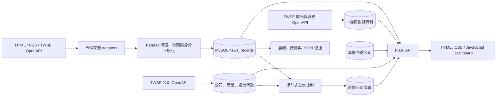

# Morning Alpha v0.3.2

Morning Alpha 是一個在本機執行的繁體中文科技與財經資訊整理系統。它把分散的新聞、TWSE 公司資料、盤後價格與季度財務摘要整合到同一個 Dashboard，並提供規則式晨報、公司關聯、事件分組及自選公司追蹤。

`v0.3.2` 是目前正式穩定版本。這個修正版改善追蹤晨報、TWSE 缺漏交易日回補、事件市場觀察的空狀態，以及來源文章數量的一致性。專案定位是個人資料整理、程式學習與作品展示；所有新聞與市場觀察均不構成投資建議。

## 使用者可以完成的任務

- 集中閱讀五個取得來源的近期科技、財經與上市公司重大訊息。
- 搜尋、排序、分頁，並依來源、分類、公司或同事件篩選新聞。
- 查看來源比重、分析分類、Top 20 中文關鍵字與資料來源健康狀態。
- 閱讀每日 07:00（Asia/Taipei）時間窗產生的規則式晨報。
- 查看新聞標題辨識出的上市公司、產業及股票代號。
- 查看 TWSE 每日盤後價格、近期缺漏交易日回補、季度財務摘要與非因果事件價格觀察。
- 以股票代號、公司名稱或簡稱搜尋並管理本機自選公司。
- 從網頁按鈕執行完整 Pipeline，完成後自動刷新資料。

## 已實作資料來源

| 取得來源 `source` | 內容 | 解析方式 | 目前範圍 |
| --- | --- | --- | --- |
| `technews` | TechNews 科技新聞 | Requests、BeautifulSoup | 首頁所有符合目前 HTML 結構的文章 |
| `cna` | 中央社財經新聞 | 官方 RSS | 財經 URL 與標題規則通過的文章 |
| `ltn` | 自由時報財經新聞 | 官方 RSS | RSS 當期文章 |
| `yahoo_tw_finance` | Yahoo股市台股動態 | Yahoo RSS 聚合來源 | RSS 當期文章；publisher 目前保存為 `Yahoo股市` |
| `twse_disclosure` | TWSE 上市公司每日重大訊息 | 官方 OpenAPI | 當日上市公司公告主旨 |

MySQL 保存所有成功取得且未被唯一鍵擋下的文章；Dashboard、來源比重、圖表與關鍵字則按每個 `source` 取發布時間最新 60 篇，因此最多使用 300 篇近期平衡樣本。這個限制不會刪除 MySQL 歷史資料。

## 系統流程



`source` 代表 Morning Alpha 實際使用的取得管道，`publisher` 代表原始發布媒體。相同 canonical URL 或同一來源文章 ID 會被 MySQL UNIQUE constraint 阻止重複寫入；不同平台報導同一事件時只分組，不刪除任何來源文章。

## 啟動方式

若已完成安裝，日常只需在 repository 根目錄執行：

```bash
python3 start.py
```

啟動器會自動使用專案 `.venv`、啟動 Flask API、等待 port 5050 就緒並開啟瀏覽器。進入 Dashboard 後，到「Pipeline 執行紀錄」按「立即更新資料」即可更新全部資料；回到 Terminal 按 `Control + C` 可停止服務。

Morning Alpha 只支援本機 Python virtual environment 與 MySQL，日常執行不會產生額外的 container images 或 build cache。

## 第一次安裝

需求：Git、Python 3.13、MySQL 8.4，以及現代瀏覽器。Node.js 22 只有執行 Playwright 測試時需要。

### 1. Clone 與安裝 Python packages

```bash
git clone https://github.com/OllieHu12304/Morning-Alpha.git
cd Morning-Alpha
python3 -m venv .venv
source .venv/bin/activate
python -m pip install -r requirements.txt
cp .env.example .env
```

### 2. 建立 MySQL database 與 app user

請以 MySQL 管理員執行，並把範例密碼換成自己的安全密碼：

```sql
CREATE DATABASE morning_alpha
CHARACTER SET utf8mb4
COLLATE utf8mb4_unicode_ci;

CREATE USER 'morning_alpha_app'@'localhost'
IDENTIFIED BY '請換成安全密碼';

GRANT CREATE, ALTER, INDEX, REFERENCES, SELECT, INSERT, UPDATE, DELETE
ON morning_alpha.*
TO 'morning_alpha_app'@'localhost';
```

把同一組 app user 與密碼填入 `.env`。這不是 Mac 登入密碼，也不要 commit `.env`。

### 3. 建立資料並啟動

```bash
./.venv/bin/python src/run_pipeline.py
python3 start.py
```

瀏覽器會開啟 [http://127.0.0.1:5050](http://127.0.0.1:5050)。既有 database 升級前請先備份，再套用尚未執行的 Migration：

```bash
./.venv/bin/python src/run_migrations.py
./.venv/bin/python src/run_migrations.py --apply
```

目前共有 Migration 001～013。

## 選用本機間隔排程

若希望電腦開機且 MySQL 正常執行時，依固定小時間隔自動更新，可以使用同一個 `.venv` 啟動 Scheduler：

```bash
./.venv/bin/python src/scheduler.py
```

間隔由 `.env` 的 `PIPELINE_INTERVAL_HOURS` 控制，預設為 24 小時。Scheduler 啟動後會先立即執行一次 Pipeline；按 `Control + C` 可停止。

## 九步 Pipeline

Dashboard 的「立即更新資料」與下列終端指令執行相同流程：

```bash
./.venv/bin/python src/run_pipeline.py
```

1. 下載、整理並寫入五個新聞來源。
2. 同步 TWSE 上市公司、產業、股票代號與別名。
3. 以預先整理的 matching context 建立新聞公司關聯。
4. 同步 TWSE 最新盤後價格，並回補最近 14 個日曆日範圍內缺少的平日資料；休市日會安全略過。
5. 同步 TWSE 季度財務摘要。
6. 產生並保存每日晨報。
7. 匯出 `news.json` 與 `metadata.json`。
8. 產生 `chart_data.json`。
9. 產生 Top 20 `keyword.json`。

Dashboard 主要讀取 Flask API 與 MySQL。`dashboard/news.json`、`chart_data.json`、`keyword.json`、`metadata.json` 是學習、檢查與備援輸出，不是網頁的正式資料來源。

## 主要技術與版本

| 類別 | 技術 |
| --- | --- |
| 後端與資料 | Python 3.13、Flask 3.1.3、Pandas 3.0.5 |
| 網路與解析 | Requests 2.34.2、BeautifulSoup 4.15.0、XML／JSON |
| 中文分析 | jieba-py 0.46.12 |
| Database | MySQL 8.4、PyMySQL 1.2.0、13 組 Migration |
| 前端 | HTML、CSS、原生 JavaScript、Chart.js 4.5.1 |
| 驗證 | Python `unittest`、Playwright 1.62.1、GitHub Actions |
| 重現環境 | Python `.venv`、鎖定版本的 requirements |

Dashboard 沒有使用 DataTables；搜尋、篩選、排序與分頁均由原生 JavaScript 實作。

## 測試

Python unit tests 不連正式 MySQL，也不依賴即時網站：

```bash
./.venv/bin/python -m unittest discover -s tests -p "test_*.py" -v
```

前端 Playwright tests：

```bash
npm ci
npx playwright install chromium
npm run test:e2e
```

`v0.3.2` 發佈前驗證結果為 317 項 Python tests 通過（其中 10 項依環境跳過），Playwright 共載入 6 項 Dashboard tests。實際 MySQL integration 與完整瀏覽器測試仍應在本機或 CI 執行。

MySQL integration tests 只允許使用 `morning_alpha_test`：

```bash
RUN_MYSQL_INTEGRATION=1 \
./.venv/bin/python -m unittest tests/test_mysql_integration.py -v
```

GitHub Actions 會在獨立 MySQL service 執行 Python、MySQL integration 與 Playwright tests，不會連進使用者 Mac 的 localhost。

## 已知限制

- 新聞摘要只使用標題與結構化欄位，不會讀取文章全文，也不是生成式 AI 摘要。
- 公司辨識、分類、事件分組及關鍵字分析都是規則式方法，可能漏判或誤判。
- TechNews 只解析首頁，不翻頁或自動回補歷史；TWSE 重大訊息只保存公告主旨等目前 adapter 欄位。
- Yahoo股市 RSS 沒有原始 publisher 欄位，目前誠實保存為 `Yahoo股市`。
- 自由時報 RSS 目前只適用個人／非商業情境；商業使用前必須重新確認授權。
- 市場價格是 TWSE 每日盤後資料；Pipeline 只回補最近 14 個日曆日範圍內的缺漏平日，不是完整歷史行情。財務資料是摘要，不是即時行情或完整財報。
- Event Observation 需要新聞已成功連結公司，且至少具有事件附近兩個可用交易日；資料不足時 Dashboard 會說明缺少的條件。
- 「資料來源狀態」的「新聞列表篇數」採用與 Latest News 相同的每來源最新 60 篇平衡樣本，不代表爬蟲當次下載或 MySQL 累積總數。
- 事件與價格只呈現時間關聯，沒有控制其他市場因素，不能推論因果。
- 只涵蓋 TWSE 上市公司；沒有 TPEx、海外市場、帳號、多使用者隔離或主動推播。
- Flask API 沒有 authentication、rate limiting、HTTPS 或 production server，不可直接公開到 Internet。
- 外部網站、RSS 或 OpenAPI 改版後，adapter 可能需要人工維護。

## 文件

- [完整使用手冊](docs/USER_GUIDE.md)：安裝、執行、Database schema、Dashboard 與疑難排解。
- [專案更迭歷史](docs/PROJECT_HISTORY.md)：各 Feature、Fix、效能改善與學習重點。
- [資料來源設計](docs/DATA_SOURCES.md)：來源欄位契約及相關限制。

## License 與資料責任

Repository 目前未提供獨立 LICENSE 檔案。第三方新聞與市場資料仍受各來源條款及著作權限制；使用者應自行確認其使用情境是否符合來源規範。Morning Alpha 不保存文章全文，Dashboard 的外部連結會導向原始來源。
