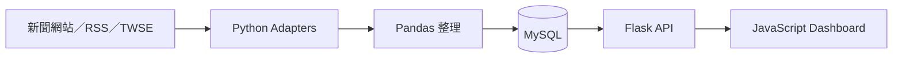
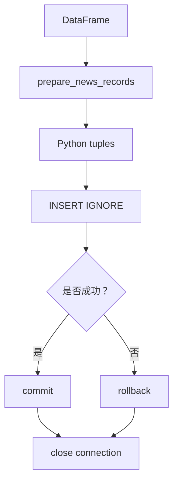
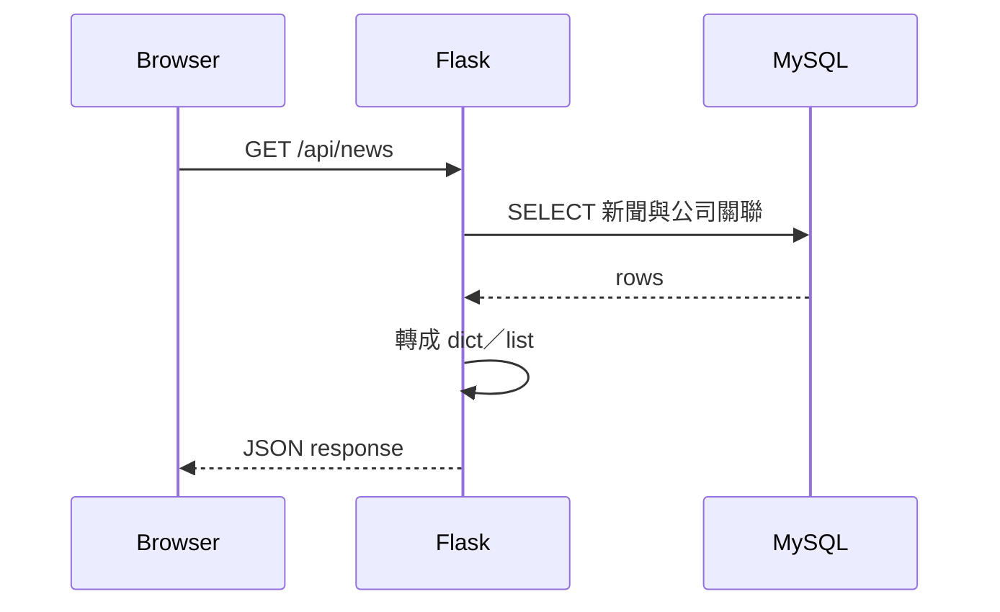
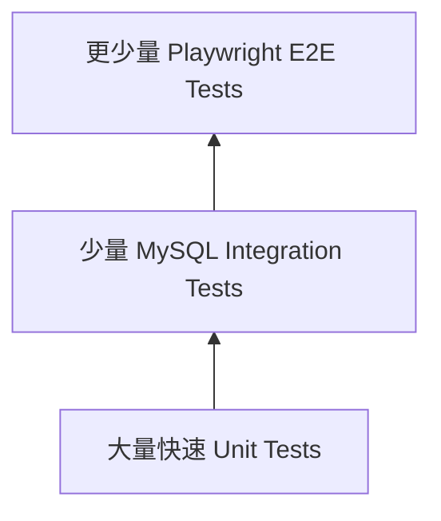

# Morning Alpha 初學者導讀講義

> 適用版本：`v0.3.2`  
> 適合對象：學過基礎 Python、Pandas、Requests、BeautifulSoup、SQL、HTML 與 JavaScript，但還沒接觸完整專案架構的人。

這份講義不要求你一次看懂 Morning Alpha。你只需要跟著一條主線：

> 一則新聞如何從外部網站進入 Python，經過 Pandas 和 MySQL，再透過 Flask API 出現在 Dashboard？

全講義共 8 課，每課約 45～75 分鐘。每次只讀指定檔案、完成小練習，確認理解後再往下走。

---

## 使用方法

每課按照下面順序進行：

1. 先讀「本課目標」，不要急著開所有程式。
2. 只開本課指定的 1～3 個檔案。
3. 跟著指令操作。
4. 用自己的話回答「下課前檢查」。
5. 答不出來時，只回頭重看本課，不必搜尋整個 repository。

建議建立學習 branch，避免實驗影響正式版本：

```bash
git switch -c codex/learning-morning-alpha
```

這份講義中的觀察指令不會修改正式資料；遇到「動手練習」時，優先在 `tests/` 或自己的練習檔進行。

---

# 第一部分：先看懂全貌

## 第 1 課：Morning Alpha 到底由哪些東西組成？

### 本課目標

完成後，你應該能分辨：

- Pipeline 是更新資料。
- MySQL 是保存正式資料。
- Flask API 是把資料交給網頁。
- Dashboard 是使用者看到的畫面。

### 先看這張圖



把它想成餐廳：

| 專案元件 | 餐廳比喻 | 實際工作 |
| --- | --- | --- |
| Adapter | 採購人員 | 從不同來源取得原料 |
| Pandas | 備料區 | 統一格式、轉換時間、排序 |
| MySQL | 冷藏庫 | 長期保存結構化資料 |
| Flask API | 出餐窗口 | 按照網頁要求送出 JSON |
| JavaScript | 服務人員 | 取得 JSON 並更新畫面 |
| Dashboard | 餐桌 | 使用者實際操作的介面 |

### 兩個最重要的入口

日常啟動 Dashboard：

```bash
python3 start.py
```

手動更新資料並查看完整過程：

```bash
./.venv/bin/python src/run_pipeline.py
```

兩者不是同一件事：

- `start.py` 啟動服務，讓瀏覽器可以進入 `http://127.0.0.1:5050`。
- `run_pipeline.py` 執行九個資料更新步驟，執行完就結束。

### 閱讀任務

只打開：

- `README.md`
- `src/run_pipeline.py`

先找到 `run_pipeline()`，暫時不要理解每個 import。只看九個 `Step` 的名稱。

### 下課前檢查

請用一句話回答：

1. Pipeline 和 Dashboard 有什麼不同？
2. 關閉 `start.py` 後，為什麼瀏覽器不能繼續讀 API？
3. Pipeline 執行成功後，正式資料主要保存在哪裡？

---

# 第二部分：跟著一則新聞走

## 第 2 課：Adapter 如何把不同來源變成共同格式？

### 本課目標

理解為什麼 TechNews、RSS 和 TWSE 雖然格式不同，後面的程式仍能用同一套處理方式。

### 先認識三種外部格式

| 格式 | 專案例子 | Python 如何讀 |
| --- | --- | --- |
| HTML | TechNews 首頁 | BeautifulSoup |
| XML／RSS | 中央社、自由時報、Yahoo股市 | XML parser |
| JSON | TWSE OpenAPI | `response.json()` |

問題是：三種資料的欄位名稱和結構都不一樣。

Morning Alpha 的做法，是要求所有 adapter 最後交出同一種 Python `dict`：

```python
{
    "source": "cna",
    "publisher": "中央社",
    "source_article_id": "example-123",
    "source_category": "財經",
    "title": "新聞標題",
    "publish_time": datetime(...),
    "url": "https://example.com/news"
}
```

這個共同格式定義在：

- `src/news_record.py`

### 為什麼要這樣設計？

如果沒有共同格式，Pandas 可能要寫成：

```python
if source == "technews":
    # 使用 TechNews 欄位
elif source == "cna":
    # 使用 CNA 欄位
elif source == "twse":
    # 使用 TWSE 欄位
```

每新增來源，後面所有模組都要跟著改。

使用共同格式後：

```text
不同外部格式
→ 各自 Adapter 負責翻譯
→ 統一 News Record
→ 後面的 Pandas／MySQL 不必知道來源細節
```

這種做法稱為 **Adapter Pattern**。現在只需要記得白話意思：

> Adapter 是翻譯員，負責把外部資料翻譯成專案內部的共同語言。

### 閱讀任務

依序打開：

1. `src/news_record.py`
2. `src/news_sources.py`
3. `src/cna_finance_adapter.py`

在程式中找出：

- 哪些欄位不能空白？
- `publish_time` 為什麼必須是 `datetime`？
- 某個來源失敗時，其他來源是否仍會繼續？

### 動手練習

執行共同格式測試：

```bash
./.venv/bin/python -m unittest tests/test_news_record.py -v
```

接著閱讀這個測試名稱：

```text
test_create_news_record_rejects_empty_required_text
```

它在表達：標題只有空白時，程式必須拒絕這筆資料，而不是讓髒資料繼續進入 MySQL。

### 下課前檢查

1. Adapter 的輸入和輸出分別是什麼？
2. 為什麼不同來源不能直接把原始資料交給 Database？
3. `source` 和 `publisher` 有什麼不同？

參考答案：`source` 是 Morning Alpha 實際取得資料的管道；`publisher` 是文章顯示的發布媒體。聚合來源中兩者可能不同。

---

## 第 3 課：Pandas 做了什麼？

### 本課目標

理解 Pandas 在這個專案中主要負責格式轉換、排序和分析，不是永久儲存資料。

### 閱讀檔案

- `src/analyze_news.py`

核心流程只有三件事：

```python
dataframe = pd.DataFrame(articles)
dataframe["publish_time"] = pd.to_datetime(...)
dataframe = dataframe.sort_values(...)
```

白話解釋：

1. 把多筆新聞 `list[dict]` 轉成表格。
2. 確保發布時間是可以排序的時間型別。
3. 依發布時間由新到舊排列。

### 資料型態的變化

```text
Adapter 輸出：list 裡面放很多 dict
                  ↓
Pandas 輸出：DataFrame
                  ↓
Database 寫入：每列轉成 tuple
```

這裡很重要：同一筆資料在不同階段可能使用不同容器，但內容代表同一則新聞。

### `errors="coerce"` 是什麼？

```python
pd.to_datetime(value, errors="coerce")
```

無法轉成時間的值會變成 Pandas 的缺值 `NaT`。後面寫入 MySQL 前會檢查並拒絕它。

這是兩層防護：

1. Pandas 不因單一錯誤時間立刻崩潰。
2. Database 寫入前不允許錯誤資料通過。

### 動手練習

在 Python shell 中輸入：

```python
import pandas as pd

records = [
    {"title": "較舊新聞", "publish_time": "2026-08-11 09:00"},
    {"title": "較新新聞", "publish_time": "2026-08-12 10:00"},
    {"title": "錯誤時間", "publish_time": "不知道"},
]

df = pd.DataFrame(records)
df["publish_time"] = pd.to_datetime(df["publish_time"], errors="coerce")
print(df.sort_values("publish_time", ascending=False))
```

觀察「錯誤時間」變成什麼。

再執行專案測試：

```bash
./.venv/bin/python -m unittest tests/test_analyze_news.py -v
```

### 下課前檢查

1. 為什麼不用 DataFrame 當永久 Database？
2. `ascending=False` 代表什麼？
3. `NaN`、`NaT` 和 SQL `NULL` 都代表缺值，但是否屬於完全相同的 Python 型別？

---

## 第 4 課：新聞如何寫進 MySQL？

### 本課目標

看懂 Python 如何連線、準備 SQL、寫入資料，以及為什麼需要 commit 和 rollback。

### 閱讀檔案

- `src/store_news.py`
- `src/read_news.py`

### 寫入流程



### 先理解四個 Database 名詞

| 名詞 | 白話解釋 | 專案例子 |
| --- | --- | --- |
| Primary key | 每列獨一無二的內部編號 | `news_records.id` |
| UNIQUE | 不允許重複的欄位組合 | canonical URL hash |
| Index | 加速查詢的目錄 | publisher index |
| Transaction | 一組要一起成功或一起取消的操作 | insert 後 commit／rollback |

### 為什麼不用標題去重？

兩家媒體可能使用相同標題，但仍是兩篇不同文章；同一篇文章也可能稍後修改標題。

目前主要依靠：

- canonical URL hash
- `source + source_article_id`

來阻止相同文章重複寫入。

不同媒體描述同一事件時，不會刪除文章，只會在後續做事件分組。

### 為什麼要 commit／rollback？

把 transaction 想成銀行轉帳：扣款與入帳必須一起成功。

- `commit()`：確認這次修改。
- `rollback()`：發生錯誤，取消尚未確認的修改。
- `finally: close()`：無論成功失敗都釋放連線。

### 為什麼 SQL 使用 `%s`？

專案使用 parameterized SQL：

```python
cursor.execute(
    "SELECT * FROM companies WHERE name = %s",
    (company_name,),
)
```

不要自己把文字拼進 SQL。Parameterized SQL 能正確處理輸入，也能降低 SQL injection 風險。

### 觀察資料

如果本機有 MySQL client，可以練習：

```sql
SELECT id, source, publisher, title, publish_time
FROM news_records
ORDER BY publish_time DESC
LIMIT 10;
```

如果沒有 MySQL CLI，先閱讀 `src/read_news.py` 中的 `SELECT` 和 `create_news_dataframe()` 即可。

### 下課前檢查

1. UNIQUE constraint 和一般 index 有什麼不同？
2. 哪些情況應該 rollback？
3. 為什麼 `connection.close()` 放在 `finally`？
4. canonical URL 去重和事件分組有什麼不同？

---

# 第三部分：資料如何進入網頁

## 第 5 課：Flask API 是 Database 和網頁的橋樑

### 本課目標

理解 Browser 不會直接連 MySQL，而是透過 HTTP 向 Flask 要 JSON。

### 閱讀檔案

- `src/api.py`

先只看三個 route：

```python
@app.get("/api/health")
@app.get("/api/news")
@app.get("/api/analytics")
```

### `/api/news` 的流程



### API 是什麼？

在這個專案中，可以把 API 理解為一組網址規則：

- 指定可以做什麼事情。
- 指定要傳入什麼。
- 指定會回傳什麼 JSON。
- 指定失敗時的 HTTP status code。

例如：

```json
{
  "count": 1,
  "news": [
    {
      "title": "新聞標題",
      "source": "cna"
    }
  ]
}
```

最外層是 JSON object，`news` 才是 array。前端必須依照這個格式讀取。

### 動手練習

啟動專案：

```bash
python3 start.py
```

另開 Terminal：

```bash
curl http://127.0.0.1:5050/api/health
curl http://127.0.0.1:5050/api/news
```

第一個請求只證明 Flask 能回應，不代表 MySQL 裡一定有新聞。

### 必學的 HTTP methods

| Method | 意思 | Morning Alpha 範例 |
| --- | --- | --- |
| GET | 讀取資料 | `/api/news` |
| POST | 建立資料或啟動動作 | `/api/pipeline/run` |
| DELETE | 刪除指定資料 | `/api/watchlist/<company_id>` |

### 下課前檢查

1. 為什麼 JavaScript 不直接連 MySQL？
2. `/api/health` 成功能證明哪些事情？不能證明哪些事情？
3. API 回傳的 Python `dict` 如何變成 JSON？

---

## 第 6 課：JavaScript 如何把 JSON 畫到 Dashboard？

### 本課目標

理解 `fetch → state → render`，這是目前 Dashboard 最重要的前端模式。

### 閱讀檔案

- `dashboard/index.html`
- `dashboard/app.js`

不要從 `app.js` 第一行一路讀到底。只搜尋這四個函式：

```text
fetchJson
loadNews
getFilteredRecords
renderTable
```

### 新聞列表的前端流程

```text
loadNews()
→ fetchJson("/api/news")
→ 檢查 payload.news 是不是 array
→ 保存到 newsRecords
→ populateFilters()
→ renderTable()
```

這裡的 `newsRecords` 是前端目前持有的資料，稱為 **state（狀態）**。

使用者搜尋時，不需要重新查 MySQL，而是：

```text
newsRecords
→ filter
→ sort
→ slice 當頁資料
→ 建立 table rows
```

### `async/await` 的白話解釋

API 需要時間回應，JavaScript 不能假設結果立刻出現：

```javascript
const payload = await fetchJson(NEWS_API);
```

`await` 表示：這個 async function 在這裡等待 Promise 完成，再繼續使用結果。等待期間，Browser 不必凍結整個畫面。

### 為什麼前端還要驗證 JSON？

```javascript
if (!payload || !Array.isArray(payload.news)) {
    throw new Error("news API 格式不正確。");
}
```

因為 API、網路或資料都可能出錯。好的畫面至少要能顯示 error state，而不是留下無止盡空白。

### 動手觀察

1. 啟動 Dashboard。
2. 開啟 Browser Developer Tools。
3. 進入 Network。
4. 重新整理頁面。
5. 點選 `/api/news`。
6. 查看 Response。

再到 Console 輸入：

```javascript
fetch("/api/health").then(response => response.json()).then(console.log)
```

### 下課前檢查

1. `fetch` 回傳的為什麼不是立即可用的 JSON？
2. `newsRecords` 的用途是什麼？
3. 搜尋、排序、分頁的正確順序是什麼？
4. loading、empty、success、error 四種 UI state 有何不同？

---

# 第四部分：理解整條 Pipeline

## 第 7 課：九個步驟為什麼要照順序？

### 本課目標

理解 Pipeline 是協調者，不是把所有程式塞在一起的大函式。

### 閱讀檔案

- `src/run_pipeline.py`

### 九步簡表

| Step | 工作 | 主要輸出 |
| --- | --- | --- |
| 1 | 取得、整理、保存新聞 | `news_records` |
| 2 | 同步公司、產業、ticker、alias | 公司相關 tables |
| 3 | 把新聞標題連到公司 | `news_company_links` |
| 4 | 同步最新價格並回補近期缺口 | `market_prices` |
| 5 | 同步季度財務摘要 | `financial_metrics` |
| 6 | 產生晨報 | `daily_briefs` |
| 7 | 匯出新聞 JSON 備援 | `news.json` 等 |
| 8 | 產生圖表 JSON | `chart_data.json` |
| 9 | 產生關鍵字 JSON | `keyword.json` |

### 為什麼不能任意交換？

Step 3 需要先有：

- Step 1 的新聞。
- Step 2 的公司名稱、簡稱、ticker 和 alias。

事件市場觀察需要：

- 新聞公司關聯。
- 至少兩個可用交易日價格。

這種「A 完成後 B 才能做」的關係稱為 dependency。

### 五個現在只需記住的架構名詞

| 名詞 | 白話解釋 | 專案例子 |
| --- | --- | --- |
| ETL | 取得、轉換、載入資料 | 新聞進入 MySQL |
| Orchestration | 安排工作順序 | `run_pipeline.py` |
| Idempotency | 重跑不應製造錯誤重複 | UNIQUE、upsert |
| Logging | 保存程式發生了什麼 | retry、failure log |
| Observability | 能判斷系統內部狀態 | source health、duration、freshness |

### 除錯時的固定問法

遇到 Dashboard 沒資料時，不要直接修改 CSS 或 JavaScript。按照資料方向檢查：

```text
來源有回應嗎？
→ Adapter 有產生 record 嗎？
→ Pandas 欄位正確嗎？
→ MySQL 有資料嗎？
→ API JSON 有資料嗎？
→ JavaScript 有成功 render 嗎？
```

### 動手練習

執行 Pipeline，為每一步抄下：

```text
開始時間：
執行秒數：
輸出筆數：
是否使用外部網站：
是否讀寫 MySQL：
```

不用一次查完內部程式。先從 terminal output 推理，再回程式確認。

### 下課前檢查

1. `run_pipeline.py` 為什麼叫 orchestration？
2. 為什麼來源全部失敗時應停止，而單一來源失敗可以繼續？
3. API 成功回應是否等於資料日期一定最新？
4. 為什麼同一 Pipeline 應該可以安全重跑？

---

# 第五部分：學會用測試保護理解

## 第 8 課：測試不是考試，而是可重複的證明

### 本課目標

分辨 unit、integration 和 E2E tests，並知道遇到 bug 時先寫哪一種。

### 三層測試



| 測試 | 驗證內容 | 專案例子 |
| --- | --- | --- |
| Unit | 單一函式 | 時間解析、URL 正規化 |
| Integration | Python 與真實 MySQL 合作 | insert、constraint、transaction |
| E2E | Browser 模擬使用者 | 搜尋、分頁、按 Pipeline 按鈕 |

### Fixture 是什麼？

`tests/fixtures/` 保存固定 HTML、XML 和 JSON。

Crawler 測試不應每次連即時網站，否則測試可能因網路、新聞變動或網站限制而失敗。Fixture 讓 parser 每次面對相同輸入，因此結果可以重現。

### Mock 是什麼？

Mock 是假的 dependency。例如測試 API 時，用假的 Database 結果取代真實 MySQL，讓測試只關心 API 如何處理資料。

### 測試的基本結構

```text
Given：準備資料
When：執行函式
Then：檢查結果
```

專案案例：

```text
Given：標題是「中華電攜手 Nokia」
When：執行公司比對
Then：只應連結中華電，不應連結華電或中華
```

這種測試也叫 regression test：防止修過的 bug 再次出現。

### 建議執行順序

先跑一個小測試：

```bash
./.venv/bin/python -m unittest tests/test_news_record.py -v
```

再跑全部 Python tests：

```bash
./.venv/bin/python -m unittest discover -s tests -p "test_*.py" -v
```

最後才跑 Browser tests：

```bash
npm run test:e2e
```

### 下課前檢查

1. 為什麼 adapter unit test 不應依賴即時網站？
2. Fixture 和 mock 有什麼不同？
3. 為什麼不能只寫 E2E tests？
4. 修正 bug 前先寫一個會失敗的測試，有什麼好處？

---

# 附錄 A：四週輕量讀書計畫

每週安排 3 次，每次約 60 分鐘。

| 週次 | 第一次 | 第二次 | 第三次 |
| --- | --- | --- | --- |
| 第 1 週 | 第 1 課：全貌 | 第 2 課：Adapter | 重跑測試並畫資料流 |
| 第 2 週 | 第 3 課：Pandas | 第 4 課：MySQL | 寫五條 SELECT／JOIN |
| 第 3 週 | 第 5 課：Flask API | 第 6 課：JavaScript | 用 DevTools 追 `/api/news` |
| 第 4 週 | 第 7 課：Pipeline | 第 8 課：Tests | 用自己的話完整講一次專案 |

每次 60 分鐘可以這樣分配：

- 10 分鐘：複習上一課。
- 20 分鐘：閱讀指定程式。
- 20 分鐘：動手操作。
- 10 分鐘：回答下課前檢查。

---

# 附錄 B：第二輪再學的技術

完成前八課後，再依這個順序深入，不需要現在一起學。

## 1. Database Migration

先讀：

- `src/run_migrations.py`
- `sql/001...013`

要搜尋的教材關鍵字：

- database migration
- schema versioning
- backward compatibility
- idempotent migration

## 2. 中文文字分析

先讀：

- `src/analyze_keywords.py`
- `src/company_matching.py`
- `src/event_grouping.py`

要搜尋：

- 中文斷詞
- jieba dictionary
- precision and recall
- false positive and false negative
- Jaccard similarity

## 3. Docker

先讀：

- `Dockerfile`
- `compose.yaml`

只需先分清楚：

- Image：環境模板。
- Container：正在執行的 instance。
- Volume：持久保存 MySQL 資料。
- Build cache：加速建置但會占空間。

## 4. GitHub Actions／CI

先讀：

- `.github/workflows/ci.yml`

要搜尋：

- CI vs CD
- GitHub Actions workflow
- YAML basics
- service container
- reproducible environment

## 5. Web 安全

目前專案只適合本機使用。若未來希望公開服務，再學：

- authentication
- authorization
- HTTPS
- rate limiting
- CORS
- production WSGI server
- secrets management

---

# 附錄 C：一頁名詞表

| 名詞 | 初學者版本解釋 |
| --- | --- |
| Adapter | 把外部格式翻譯成專案共同格式 |
| Data Contract | 模組之間約定資料必須有哪些欄位和型別 |
| ETL | Extract、Transform、Load；取得、整理、載入資料 |
| Pipeline | 依順序執行的一連串資料工作 |
| Schema | Database table 的欄位與規則 |
| Migration | 把舊 Schema 安全升級到新版 |
| Transaction | 一組一起確認或一起取消的 Database 操作 |
| API | 前後端約定如何請求與回傳資料 |
| Endpoint | API 的特定網址與操作 |
| JSON | 前後端交換結構化資料的文字格式 |
| State | 前端目前記住的資料與操作狀態 |
| Promise | JavaScript 中代表未來才會完成的結果 |
| Fixture | 測試使用的固定輸入檔案 |
| Mock | 測試時取代真實 dependency 的假物件或假函式 |
| Idempotent | 同一操作安全重跑，結果不會錯誤累加 |
| Logging | 保存程式執行事件與錯誤 |
| Observability | 能從狀態、log、時間與筆數理解系統內部情況 |
| CI | 每次 push 後在乾淨環境自動執行測試 |

---

# 最終口頭驗收

完成講義後，嘗試不看程式，用 3 分鐘說明：

> Morning Alpha 從多個 HTML、RSS 和 TWSE JSON 來源取得資料。每個 adapter 把外部格式轉成共同 News Record，Pandas 負責型別轉換和排序，再由 PyMySQL 寫進 MySQL。Flask API 從 MySQL 讀取資料並回傳 JSON，JavaScript 使用 fetch 取得 JSON，保存成前端 state，再完成篩選、排序、分頁和畫面渲染。九步 Pipeline 負責安排新聞、公司、價格、財務和分析工作的相依順序；fixtures、unit tests、MySQL integration tests 和 Playwright tests 分別保護不同層次的功能。

如果你能不用背誦、改用自己的例子說出這段流程，就已經掌握 Morning Alpha 最核心的架構。
