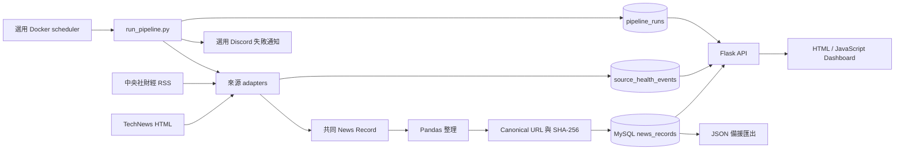

# Morning Alpha v0.2 Alpha 使用手冊

本手冊只描述目前 repository 已實作的功能。Morning Alpha 的第三階段自動化功能已收斂：v0.2 Alpha 不再擴充新的維運功能，接下來以驗證、修正阻擋 release 的問題與準備版本標籤為主。

## 1. 專案概覽

Morning Alpha 是一個繁體中文科技與財經新聞資料專案。它把「到不同網站找新聞、整理欄位、判斷重複、做統計、在網頁閱讀」整合成一條可重複執行的 Pipeline。

目前使用者可以：

1. 收集 TechNews 與中央社財經新聞。
2. 將不同來源轉成一致的資料格式。
3. 使用 Pandas 清理資料並儲存到 MySQL。
4. 透過 Flask API 在 Dashboard 搜尋、篩選及閱讀新聞。
5. 查看來源、分類、熱門關鍵字、來源健康狀態與 Pipeline 執行紀錄。
6. 選擇以 Docker scheduler 定期更新資料，並在失敗時傳送 Discord 通知。

它適合正在學習 Python、資料處理、MySQL、API 與前端基礎的初學者，也可作為 junior developer／data-related 面試時說明端到端資料流程的作品。

Morning Alpha 不是投資建議系統，不會提供買賣訊號或預測報酬。

## 2. 目前功能

### 核心資料功能

| 功能 | 實際行為 | 主要技術 |
| --- | --- | --- |
| 多來源收集 | 解析 TechNews HTML 與中央社財經 RSS | Requests、BeautifulSoup、adapter pattern |
| 共同資料格式 | 所有來源都輸出相同的新聞欄位 | Python dict、欄位驗證 |
| HTTP retry | 下載失敗最多嘗試 3 次，並記錄 log | Requests、logging |
| 部分來源容錯 | 單一來源失敗時繼續處理其他來源；全部失敗才中止 | Python 例外處理 |
| Pandas 整理 | 轉換發布時間、排序、處理缺值 | Pandas |
| MySQL 儲存 | 累積保存新聞及維運紀錄 | MySQL、PyMySQL |
| URL 去重 | canonical URL 轉 SHA-256，由 UNIQUE index 防止相同網址重複 | `urllib.parse`、`hashlib`、MySQL |
| 雙分類 | 分開保存來源官方分類與 Morning Alpha 分析分類 | Python |
| 中文關鍵字 | 使用 jieba 斷詞，再以 Pandas 計算 Top 20 | jieba-py、Pandas |
| 事件分組 | 將時間與標題詞彙相近的文章分組，但不刪除文章 | Python、Jaccard similarity |
| Flask API | 從 MySQL 提供新聞、統計與健康資料 | Flask |
| Dashboard | 搜尋、來源／分類篩選、排序、分頁、圖表與同事件閱讀 | HTML、CSS、JavaScript、Chart.js |

### 選配維運功能

| 功能 | 實際行為 | 使用條件 |
| --- | --- | --- |
| Docker 環境 | 提供一致的 Python、MySQL 與 API 執行環境 | 安裝 Docker Desktop |
| 本機 scheduler | 啟動後立即執行一次，再按小時間隔重跑 Pipeline | Mac、Docker Desktop 與 container 必須持續運作 |
| 來源健康紀錄 | 保存各來源每次成功／失敗、文章數與錯誤摘要 | Pipeline 可連線 MySQL |
| Pipeline 歷史 | 保存整體狀態、耗時、失敗步驟與四步驟摘要 | Pipeline 可連線 MySQL |
| 歷史保留 | 預設刪除 90 天以前的健康與執行紀錄 | MySQL app user 具有 `DELETE` 權限 |
| Discord 失敗通知 | Pipeline 失敗時傳送一次安全化訊息 | 自行設定 Discord Webhook URL |
| GitHub Actions CI | 自動執行 Python、MySQL integration 與 Playwright tests | Push 或 Pull Request 到 GitHub |

Dashboard 沒有使用 DataTables；搜尋、篩選、排序與分頁由原生 JavaScript 實作。

## 3. 系統工作流程



實際資料流重點：

- MySQL 是累積資料的主要儲存位置。
- Flask API 直接讀取 MySQL，Dashboard 再透過 `fetch()` 呼叫 API。
- Pipeline 仍產生四個 JSON，供學習、除錯與備援使用；目前 Dashboard 不依賴這些 JSON。
- canonical URL 防止相同網址重複；不同平台報導同一事件時只分組，不刪除任何來源文章。

## 4. 專案結構

以下省略 `.git/`、`.venv/`、`node_modules/`、`__pycache__/` 與 runtime 產物：

```text
Morning-Alpha/
├── .github/workflows/ci.yml
├── .env.example
├── .gitignore
├── Dockerfile
├── compose.yaml
├── README.md
├── requirements.txt
├── package.json
├── package-lock.json
├── src/
│   ├── run_pipeline.py
│   ├── scheduler.py
│   ├── api.py
│   ├── run_migrations.py
│   ├── news_sources.py
│   ├── technews_adapter.py
│   ├── cna_finance_adapter.py
│   ├── http_client.py
│   ├── analyze_news.py
│   ├── store_news.py
│   ├── export_news_json.py
│   ├── analyze_keywords.py
│   ├── generate_chart_data.py
│   ├── event_grouping.py
│   ├── source_health.py
│   ├── pipeline_history.py
│   ├── history_retention.py
│   └── failure_notification.py
├── sql/
│   ├── 001_add_news_quality_fields.sql
│   ├── 002_add_canonical_url_hash.sql
│   ├── 003_enforce_canonical_url_uniqueness.sql
│   ├── 004_remove_title_unique.sql
│   ├── 005_create_source_health_events.sql
│   └── 006_create_pipeline_runs.sql
├── dashboard/
│   ├── index.html
│   ├── styles.css
│   ├── app.js
│   └── *.json
├── data/
│   ├── raw/jieba_user_dictionary.txt
│   └── processed/
├── tests/
│   ├── fixtures/
│   └── test_*.py
└── docs/
    └── USER_GUIDE.md
```

### 重要檔案

| 檔案 | 作用與執行時機 | 互動對象 |
| --- | --- | --- |
| `src/run_pipeline.py` | 日常資料更新的統一入口 | adapters、Pandas、MySQL、JSON、歷史與通知模組 |
| `src/scheduler.py` | 選用的 Docker 本機間隔排程 | `run_pipeline.py` |
| `src/api.py` | 提供 Dashboard 與五個 API endpoints | MySQL、Dashboard |
| `src/news_sources.py` | 集中呼叫所有來源 adapters，隔離單一來源錯誤 | TechNews、CNA adapters |
| `src/technews_adapter.py` | 解析 TechNews 首頁，最多取得 5 篇 | Requests、BeautifulSoup |
| `src/cna_finance_adapter.py` | 解析中央社產經證券 RSS | Requests、BeautifulSoup |
| `src/http_client.py` | 共用 timeout、retry 與 logging | 所有來源 adapters |
| `src/analyze_news.py` | 建立與整理 DataFrame | Pandas、來源資料 |
| `src/store_news.py` | 建立最新 schema、準備 canonical URL/hash、寫入新聞 | MySQL、PyMySQL |
| `src/run_migrations.py` | 唯讀檢查或依序套用 001～006 migrations | `sql/`、MySQL |
| `src/export_news_json.py` | 匯出新聞與最後更新時間 | MySQL、`news.json`、`metadata.json` |
| `src/analyze_keywords.py` | jieba 斷詞與 Top 20 計數 | Pandas、`keyword.json` |
| `src/generate_chart_data.py` | 計算來源與分類統計 | `chart_data.json` |
| `src/event_grouping.py` | 為相似新聞加入事件群組資訊 | API、JSON 匯出 |
| `src/source_health.py` | 儲存與讀取來源健康紀錄 | `source_health_events` |
| `src/pipeline_history.py` | 儲存與讀取 Pipeline 執行紀錄 | `pipeline_runs` |
| `src/history_retention.py` | 刪除過期維運歷史，不刪新聞 | 兩張歷史 tables |
| `src/failure_notification.py` | 選擇性傳送 Discord 失敗通知 | Discord Webhook |
| `dashboard/app.js` | 呼叫 API、繪圖並管理互動狀態 | Flask API、Chart.js |
| `.github/workflows/ci.yml` | 在 GitHub 執行三組測試工作 | Python、MySQL service、Playwright |

## 5. 系統需求

建議選擇 Docker 或原生安裝其中一種，不要混用兩套 Python／MySQL。

| 項目 | 實際要求 |
| --- | --- |
| Docker 方式 | Git、Docker Desktop、現代瀏覽器 |
| 原生方式 | Git、Python 3.13、MySQL 8.4；Playwright tests 另需 Node.js |
| 網路 | Pipeline 需連到新聞來源；圖表需連到 Chart.js CDN |
| Python packages | 版本固定於 `requirements.txt` |
| JavaScript package | `@playwright/test` 版本固定於 `package-lock.json` |

目前固定的 Python package versions：

```text
requests==2.34.2
beautifulsoup4==4.15.0
pandas==3.0.5
PyMySQL==1.2.0
jieba-py==0.46.12
python-dotenv==1.2.2
Flask==3.1.3
```

Docker 使用 `python:3.13-slim` 與 `mysql:8.4`。Dashboard 使用 Chart.js 4.5.1。

## 6. 安裝

### 方案 A：Docker（建議初學者）

#### Step 1：Clone

```bash
git clone https://github.com/OllieHu12304/Morning-Alpha.git
cd Morning-Alpha
```

#### Step 2：建立 `.env`

```bash
cp .env.example .env
```

編輯 `.env`，至少設定一組只給這份 Docker database 使用的新密碼：

```text
MYSQL_USER=morning_alpha_app
MYSQL_PASSWORD=請替換成至少20個字元的新密碼
MYSQL_DATABASE=morning_alpha
PIPELINE_INTERVAL_HOURS=24
HISTORY_RETENTION_DAYS=90
PIPELINE_FAILURE_WEBHOOK_URL=
```

這不是 Mac 登入密碼，也不需要使用作者的密碼。`.env` 已被 Git 忽略，不可 commit。

#### Step 3：建置與啟動 MySQL

```bash
docker compose build api
docker compose up -d db
docker compose ps
```

等待 `db` 顯示 `healthy`。

#### Step 4：第一次更新資料

```bash
docker compose run --rm api python src/run_pipeline.py
```

第一次執行會自動建立最新三張 tables，不需要手動執行 migration。

#### Step 5：啟動 Dashboard

```bash
docker compose up -d api
```

開啟 [http://127.0.0.1:5050](http://127.0.0.1:5050)。

### 方案 B：原生安裝

#### Step 1：建立 Python environment

```bash
git clone https://github.com/OllieHu12304/Morning-Alpha.git
cd Morning-Alpha
python3 -m venv .venv
source .venv/bin/activate
python -m pip install -r requirements.txt
```

確認使用專案 interpreter：

```bash
which python
```

輸出應以 `.venv/bin/python` 結尾。

#### Step 2：建立 MySQL database 與 app user

以 MySQL 管理員登入後執行：

```sql
CREATE DATABASE IF NOT EXISTS morning_alpha
CHARACTER SET utf8mb4
COLLATE utf8mb4_unicode_ci;

CREATE USER 'morning_alpha_app'@'localhost'
IDENTIFIED BY '請替換成安全密碼';

GRANT CREATE, INSERT, SELECT, DELETE
ON morning_alpha.*
TO 'morning_alpha_app'@'localhost';
```

#### Step 3：建立 `.env`

```bash
cp .env.example .env
```

確認下列值符合本機 MySQL：

```text
MYSQL_HOST=localhost
MYSQL_PORT=3306
MYSQL_USER=morning_alpha_app
MYSQL_PASSWORD=你的MySQL app密碼
MYSQL_DATABASE=morning_alpha
HISTORY_RETENTION_DAYS=90
PIPELINE_FAILURE_WEBHOOK_URL=
```

`MYSQL_USER` 與 `MYSQL_PASSWORD` 必須提供；其餘連線值已有預設值。Shell environment 的同名值會優先於 `.env`。

### 既有 database 升級

全新 database 不需 migration。從舊版升級時，先備份並唯讀檢查：

```bash
mysqldump -u root -p morning_alpha > ../morning_alpha_before_v0.2.sql
./.venv/bin/python src/run_migrations.py
```

確認輸出後，再以具有 `CREATE`、`ALTER`、`UPDATE` 與 `SELECT` 權限的管理員帳號套用：

```bash
./.venv/bin/python src/run_migrations.py --apply
```

Migration 會依序處理 001～006。MySQL DDL 通常會自動 commit，因此執行前必須備份。

## 7. 如何執行 Morning Alpha

### 日常手動更新

Docker：

```bash
docker compose run --rm api python src/run_pipeline.py
```

原生環境：

```bash
./.venv/bin/python src/run_pipeline.py
```

Pipeline 的四個畫面步驟：

1. 從所有 adapters 收集、整理並寫入新聞；同時保存來源健康結果。
2. 從 MySQL 匯出 `news.json` 與 `metadata.json`。
3. 產生 `chart_data.json`。
4. 產生 Top 20 `keyword.json`。

Pipeline 外層還會記錄整體成功／失敗、耗時與每個步驟摘要，接著清除過期歷史；失敗時若有設定 Webhook，才傳送 Discord 通知。

### 啟動 API 與 Dashboard

Docker：

```bash
docker compose up -d api
```

原生環境：

```bash
./.venv/bin/python src/api.py
```

開啟 [http://127.0.0.1:5050](http://127.0.0.1:5050)。不要再使用 port 8000 的靜態 server；目前 Dashboard 必須透過 Flask API 取得資料。

### 選用本機自動排程

```bash
docker compose --profile scheduler up -d api scheduler
docker compose logs -f scheduler
```

Scheduler 啟動後先執行一次，再於每次完成後等待 `PIPELINE_INTERVAL_HOURS`。停止排程但保留資料：

```bash
docker compose stop scheduler
```

這是本機排程，不是雲端排程。Mac 關機、Docker Desktop 停止或 scheduler container 停止時，就不會更新。

### 停止 Docker

```bash
docker compose down
```

這會保留 MySQL named volume。下列指令會刪除 volume 與全部 database 資料，除非確定不需要資料，否則不要執行：

```bash
docker compose down -v
```

## 8. 預期結果

### Pipeline terminal

以下是格式範例，筆數會依來源與 database 改變：

```text
Step 1/4：爬取、整理並儲存新聞…
Step 2/4：匯出 Dashboard 新聞資料…
Step 3/4：產生 Dashboard 圖表資料…
Step 4/4：產生 Top 20 關鍵字資料…
Morning Alpha 資料更新完成。
MySQL 新增新聞：<本次新增筆數> 筆
news.json 新聞：<累積筆數> 筆
chart_data.json 統計群組：3 組
keyword.json 關鍵字：<最多20> 個
```

新增 0 筆可能只是所有 canonical URLs 都已存在，不一定代表錯誤。

### API

```bash
curl http://127.0.0.1:5050/api/health
```

預期：

```json
{"status":"ok"}
```

目前 endpoints：

- `GET /`：Dashboard。
- `GET /api/health`：服務健康檢查。
- `GET /api/news`：新聞與事件群組。
- `GET /api/analytics`：來源、分類、Top 20 關鍵字與最後更新時間。
- `GET /api/source-health`：來源最近狀態。
- `GET /api/pipeline-runs`：最近 Pipeline 執行紀錄。

### JSON

Pipeline 仍會產生：

- `dashboard/news.json`
- `dashboard/chart_data.json`
- `dashboard/keyword.json`
- `dashboard/metadata.json`

`keyword.json` 示意格式：

```json
[
  {"keyword": "半導體", "count": 6},
  {"keyword": "人工智慧", "count": 4}
]
```

這些是備援輸出；Dashboard 正式資料來源是 API。

### Dashboard

頁面應顯示來源健康卡、最近五次 Pipeline、三種統計圖、最後更新時間與新聞 table。實際新聞內容依執行時間而不同。

## 9. Database

預設 database 名稱是 `morning_alpha`，目前有三張 tables。

### `news_records`

| Column | Datatype | 用途 |
| --- | --- | --- |
| `id` | `BIGINT UNSIGNED AUTO_INCREMENT` | 主鍵 |
| `source` | `VARCHAR(100) NOT NULL` | 來源代碼 |
| `source_category` | `VARCHAR(100) NULL` | 來源官方分類 |
| `analysis_category` | `VARCHAR(100) NULL` | Morning Alpha 分析分類 |
| `title` | `VARCHAR(500) NOT NULL` | 標題，不是 UNIQUE |
| `publish_time` | `DATETIME NOT NULL` | 發布時間 |
| `url` | `VARCHAR(1000) NOT NULL` | 原始 URL |
| `canonical_url` | `VARCHAR(1000) NOT NULL` | 正規化 URL |
| `canonical_url_hash` | `CHAR(64) NOT NULL` | canonical URL 的 SHA-256；具有 UNIQUE index |
| `created_at` | `TIMESTAMP` | 寫入時間 |

### `source_health_events`

| Column | Datatype | 用途 |
| --- | --- | --- |
| `id` | `BIGINT UNSIGNED AUTO_INCREMENT` | 主鍵 |
| `source` | `VARCHAR(100) NOT NULL` | 來源代碼 |
| `status` | `VARCHAR(20) NOT NULL` | 本次成功或失敗 |
| `article_count` | `INT UNSIGNED NOT NULL` | 本次解析文章數 |
| `error_message` | `VARCHAR(500) NULL` | 簡化後錯誤摘要 |
| `attempted_at` | `DATETIME NOT NULL` | 嘗試時間 |

### `pipeline_runs`

| Column | Datatype | 用途 |
| --- | --- | --- |
| `id` | `BIGINT UNSIGNED AUTO_INCREMENT` | 主鍵 |
| `status` | `VARCHAR(20) NOT NULL` | 整體成功或失敗 |
| `started_at` | `DATETIME(6) NOT NULL` | 開始時間 |
| `finished_at` | `DATETIME(6) NOT NULL` | 結束時間 |
| `duration_ms` | `BIGINT UNSIGNED NOT NULL` | 總耗時，毫秒 |
| `failed_step` | `VARCHAR(100) NULL` | 失敗步驟 |
| `step_results` | `JSON NOT NULL` | 四步驟摘要 |
| `error_message` | `VARCHAR(500) NULL` | 簡化後錯誤摘要 |

### 實用 SQL

```sql
-- 最新 20 篇
SELECT source, analysis_category, title, publish_time, url
FROM news_records
ORDER BY publish_time DESC
LIMIT 20;

-- 新聞總數
SELECT COUNT(*) AS total_news
FROM news_records;

-- 各來源新聞數
SELECT source, COUNT(*) AS article_count
FROM news_records
GROUP BY source
ORDER BY article_count DESC;

-- 只看中央社
SELECT title, publish_time, url
FROM news_records
WHERE source = 'cna'
ORDER BY publish_time DESC;

-- 各來源最近狀態
SELECT source, status, article_count, attempted_at
FROM source_health_events
ORDER BY attempted_at DESC;

-- 最近 Pipeline
SELECT status, duration_ms, failed_step, started_at
FROM pipeline_runs
ORDER BY started_at DESC
LIMIT 10;
```

## 10. Dashboard 使用方式

- 來源健康卡：查看各來源最近嘗試、最近成功、文章數與錯誤原因。
- Pipeline 紀錄：查看最近五次完整執行的狀態、耗時與四步驟結果。
- 搜尋：比對新聞標題與顯示欄位。
- 來源與分類篩選：可單獨或同時套用。
- 排序：點擊可排序的表頭切換方向。
- 分頁：選擇每頁筆數，使用上一頁／下一頁。
- 同事件：只顯示被分到同一事件群組的文章。
- 圖表：查看來源分布、分析分類與熱門關鍵字前 10 名。
- 最後更新時間：來自 MySQL 最新資料時間。

## 11. 疑難排解

### `ModuleNotFoundError`

通常是使用了 Anaconda 或系統 Python：

```bash
./.venv/bin/python -m pip install -r requirements.txt
./.venv/bin/python src/run_pipeline.py
```

### MySQL `(1045) Access denied`

確認 `.env` 的帳號、密碼、host 與實際建立的 MySQL user 相同。Docker 的密碼是在 volume 第一次建立時初始化；之後只改 `.env` 不會修改既有 user 密碼。

### `Unknown column 'source'`

舊 database 尚未完成 migrations。先備份，再執行唯讀檢查與 `--apply`。

### `nan can not be used with MySQL`

確認目前程式已包含 Pandas 缺值轉 Python `None` 的版本，且不要混用舊的 source code。

### Crawler timeout、503 或空結果

程式會自動重試。單一來源失敗時其他來源仍會繼續；全部來源失敗才中止。查看：

```bash
tail -n 100 data/processed/morning_alpha.log
```

Docker 對來源回傳 503、但 Mac 瀏覽器可開啟時，可能是來源阻擋 container 網路；稍後重試或先以原生 Pipeline 更新。

### Dashboard `Failed to fetch`

確認 Flask API 正在執行，並從 port 5050 開啟：

```bash
./.venv/bin/python src/api.py
```

不要直接雙擊 `index.html`，也不要只啟動靜態 `http.server`。

### `/` 顯示 Not Found

確認使用目前版本的 `src/api.py`，並開啟 `http://127.0.0.1:5050/`。API endpoints 則位於 `/api/...`。

### History cleanup 出現 `DELETE command denied`

以 MySQL 管理員補上 `DELETE` 權限；清理只影響兩張歷史 tables，不會刪除新聞。

### Discord 沒通知

只有失敗的 Pipeline 會通知。確認 Webhook URL 完整且未失效，再查看 log；通知失敗不會覆蓋 Pipeline 原始錯誤。

### 工作目錄錯誤

執行前用 `pwd`、`ls` 確認目前目錄含有 `src/`、`dashboard/`、`requirements.txt` 與 `compose.yaml`。

## 12. 目前限制

- 目前只有 TechNews 與中央社財經兩個來源；TechNews 每次最多解析首頁 5 篇。
- 網站 selector 或 RSS 格式改版時，adapter 仍需人工維護。
- canonical URL 只能擋相同標準網址；跨平台同事件只分組，不會自動認定為同一篇。
- 事件分組、分析分類與關鍵字都是規則式分析，可能漏判、誤判或切詞不理想。
- 沒有文章全文、AI 摘要、情緒分析、股票行情、買賣訊號或使用者帳號。
- Flask API 是本機學習用途，沒有 authentication、rate limiting 或正式公開部署設定。
- Dashboard 的分頁在瀏覽器端完成，不是 server-side pagination；資料量很大時需要改造。
- Scheduler 依賴本機 Mac 與 Docker 持續運作，不是雲端高可用排程，也不是即時資料。
- GitHub Actions 只負責 CI tests，不會連進使用者 Mac 的 MySQL，也不負責正式新聞排程。
- `.env` 適合本機 secrets；專案尚未整合雲端 secret manager。
- 歷史保留只按天數刪除，沒有內建 database／Docker volume 備份與還原工具。
- Discord 通知只有一次嘗試，沒有 retry 或多種通知管道。
- Pipeline 產生的 Docker container 內 JSON 與 log 不會自動保存到 host；Dashboard 本身不依賴 JSON。
- 先前已寫入 MySQL 的非財經舊資料不會因目前來源白名單自動刪除。

## 13. 第三階段收斂與後續方向

第三階段原定五個方向目前都有可使用的實作：

1. 定期執行：Docker 本機 scheduler。
2. 敏感設定：`.env` 與 GitHub Actions secrets／CI environment。
3. API backend：Flask API，Dashboard 不再依賴手動 JSON。
4. 測試：crawler unit tests、MySQL integration tests、Playwright tests 與 GitHub Actions CI。
5. 可重現環境：固定 Python 與 Playwright package versions，並提供 Docker。

其中「排程」與「secrets」採用適合本機初學專案的範圍，並不等於雲端 production 系統。來源健康、Pipeline 歷史、90 天保留與 Discord 通知是已完成的選配維運功能。

v0.2 接下來只處理完整驗證、文件一致性與阻擋 release 的錯誤，然後建立 release candidate／正式 tag。資料來源、分析準確度、備份或雲端部署等新需求，應另外評估並排入下一個產品階段，避免繼續偏離「繁體中文科技與財經新聞整理」核心。

## 14. 技術學習與面試說明

| 技術 | 在專案中的用途 | 面試時可說明的重點 |
| --- | --- | --- |
| Python basics | 函式拆分、dict/list、例外、環境變數與檔案路徑 | 如何把一條大流程拆成可獨立測試的模組 |
| Requests | 下載 HTML／RSS，設定 timeout 與 retry | 外部服務不可靠時如何處理失敗 |
| BeautifulSoup | 解析 HTML 與 XML fixtures | 如何把非結構化頁面轉成欄位 |
| Pandas | 時間轉換、排序、缺值處理與關鍵字統計 | 何時適合使用 DataFrame |
| MySQL | 累積新聞、來源健康與 Pipeline 歷史 | schema、index、UNIQUE constraint 與資料持久化 |
| PyMySQL | parameterized SQL、transaction、commit／rollback | Python 如何安全地操作 relational database |
| Flask | 從 MySQL 提供 JSON API 與 Dashboard | 為何 API 能取代手動讀取靜態 JSON |
| HTML | Dashboard 語意結構與表格 | 內容結構與互動控制如何分工 |
| CSS | responsive layout 與狀態樣式 | 如何讓同一頁面適應不同寬度 |
| JavaScript | API fetch、狀態管理、搜尋、篩選、排序與分頁 | 瀏覽器如何取得並呈現後端資料 |
| Chart.js | 顯示來源、分類與關鍵字圖表 | 後端負責計算、前端負責視覺化 |
| Docker | 包裝 Python、MySQL、API 與 scheduler | 如何讓不同電腦使用相同執行環境 |
| GitHub Actions | 自動執行三類 tests | CI 如何降低跨環境修改的風險 |
| Git | 每個 feature 一個 commit，schema 以 migrations 演進 | 如何保留可追蹤、可審查的開發歷史 |

面試版總結：

> Morning Alpha 是我實作的端到端新聞資料專案。我用來源 adapters 收集 HTML 與 RSS，以 Pandas 統一資料，透過 MySQL 與 canonical URL UNIQUE index 管理累積及去重，再由 Flask API 將新聞、統計與健康狀態提供給 JavaScript Dashboard。專案也包含中文斷詞、事件分組、retry、logging、migrations、Docker、排程與 CI tests。我能說明每一層使用不同技術的原因，也清楚知道規則式分析、本機排程及有限來源的邊界。

### 驗證指令

```bash
./.venv/bin/python -m unittest discover -s tests -v
node --check dashboard/app.js
docker compose config --quiet
npm run test:e2e
```

MySQL integration tests 需要獨立的 `morning_alpha_test` database 與 `.env` 中的 `MYSQL_TEST_*` 設定；一般 unit tests 不會修改正式 database。
