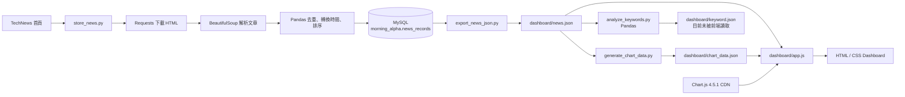

# Morning Alpha v0.1 使用手冊

本手冊依照 repository 在 `v0.1.0-alpha.8` 的實際程式碼撰寫。內容描述目前能執行的功能，不把尚未串接或規劃中的功能當成完成品。

## 1. 專案概覽

Morning Alpha v0.1 是一個繁體中文的科技新聞蒐集與視覺化學習專案。它會從 TechNews 科技新報首頁取得最多五篇文章，使用 Pandas 整理資料，將資料累積到 MySQL，最後輸出本機 JSON，交給靜態 HTML／JavaScript Dashboard 顯示。

它解決的問題是：把「開啟新聞網站、逐篇查看標題」轉成一個可以重複執行的資料流程，讓使用者在同一個頁面查看新聞列表、來源分布、主題分類與熱門關鍵字。

適合的使用者包括：

- 正在學習 Python、資料處理、MySQL 與前端基礎的初學者。
- 想快速瀏覽少量科技新聞標題的使用者。
- 想用一個小型端到端專案練習面試說明的 junior developer 或初階 data-related 求職者。

Morning Alpha v0.1 不是投資建議系統。雖然專案概念與投資晨報有關，目前實作只整理科技新聞標題與基礎統計，沒有股票價格、報酬率、AI 摘要或投資評分。

## 2. 目前功能

下表只列出 repository 中確實存在的功能。

| 功能 | 實際行為 | 主要技術 |
| --- | --- | --- |
| TechNews 首頁爬蟲 | 對 `https://technews.tw/` 發送 HTTP request，解析首頁前五個符合 selector 的文章 | Python、Requests、BeautifulSoup |
| 新聞資料整理 | 建立 DataFrame、依標題去重、轉換發布時間、由新到舊排序 | Pandas |
| MySQL 儲存 | 自動建立 `news_records` table，使用 `INSERT IGNORE` 寫入新聞 | MySQL、PyMySQL |
| MySQL 資料讀取 | 讀取所有新聞到 DataFrame，再顯示最新 20 筆 | Pandas、PyMySQL |
| Dashboard 新聞資料匯出 | 將 MySQL 全部新聞匯出為 `dashboard/news.json` | Python、Pandas、JSON |
| Dashboard 新聞列表 | 顯示 title、publish time、URL，並支援三個欄位的升冪／降冪排序 | HTML、CSS、原生 JavaScript |
| Dashboard 圖表 | 顯示來源圓環圖、分類長條圖與 Top 10 關鍵字橫向長條圖 | Chart.js 4.5.1、JavaScript |
| Top 20 關鍵字分析 | 使用候選詞庫與 Pandas 統計標題中的關鍵字總出現次數，輸出 `keyword.json` | Pandas、JSON |

### 沒有實作的相似功能

- 沒有使用 DataTables；新聞 table 是原生 HTML table 加上自製 JavaScript 排序。
- 沒有 Dashboard 搜尋框、分頁或欄位篩選。
- `keyword.json` 尚未被 Dashboard 讀取；目前頁面上的 Top 10 關鍵字來自 `chart_data.json`。

## 3. 系統工作流程

### 完整資料流



### 流程重點

1. `store_news.py` 是必要更新流程的第一個 Python 入口。它內部已經呼叫 crawler 與 Pandas 整理函式，因此不需要先執行 `crawler.py` 或 `analyze_news.py`。
2. MySQL 是累積資料的主要儲存位置；重複 title 會被忽略。
3. Dashboard 不會直接連線 MySQL，只會用 `fetch()` 讀取靜態 JSON。
4. `news.json` 是兩個後續分析的共同輸入：
   - `generate_chart_data.py` 產生 Dashboard 正在使用的 `chart_data.json`。
   - `analyze_keywords.py` 產生尚未接入 Dashboard 的 `keyword.json`。
5. `crawler.py`、`analyze_news.py` 與 `read_news.py` 是有用的學習／除錯入口，但不是每次更新 Dashboard 都必須依序執行的 pipeline stages。

## 4. 專案結構

以下是目前 Git repository 的實際主要結構；建立本手冊後會多出 `docs/USER_GUIDE.md`。

```text
Morning-Alpha/
├── .gitignore
├── .vscode/
│   └── settings.json
├── README.md
├── requirements.txt
├── docs/
│   └── USER_GUIDE.md
├── src/
│   ├── .gitkeep
│   ├── crawler.py
│   ├── analyze_news.py
│   ├── store_news.py
│   ├── read_news.py
│   ├── export_news_json.py
│   ├── generate_chart_data.py
│   ├── analyze_keywords.py
│   └── __pycache__/
│       ├── crawler.cpython-313.pyc
│       ├── analyze_news.cpython-313.pyc
│       └── store_news.cpython-313.pyc
├── dashboard/
│   ├── .gitkeep
│   ├── index.html
│   ├── styles.css
│   ├── app.js
│   ├── news.json
│   ├── chart_data.json
│   └── keyword.json
├── data/
│   ├── raw/
│   │   └── .gitkeep
│   └── processed/
│       └── .gitkeep
├── sql/
│   └── .gitkeep
└── tests/
    ├── .gitkeep
    ├── test_generate_chart_data.py
    └── test_analyze_keywords.py
```

> 注意：三個 `.pyc` bytecode 檔目前確實被 Git 追蹤。`.gitignore` 雖然已包含 `__pycache__/` 與 `*.py[cod]`，但 Git 不會自動停止追蹤較早提交的檔案。這是 repository hygiene 問題，不是執行需求。

### 重要檔案與互動關係

| 檔案 | 用途 | 何時執行 | 互動對象 |
| --- | --- | --- | --- |
| `src/crawler.py` | 下載 TechNews 首頁，解析最多五篇文章並印出 | 單獨測試 crawler 時 | TechNews、Requests、BeautifulSoup |
| `src/analyze_news.py` | 重新爬取新聞，建立並整理 DataFrame，印出結果 | 單獨觀察 Pandas 轉換時 | `crawler.py`、Pandas |
| `src/store_news.py` | 爬取、整理、建立 table、寫入 MySQL | 每次收集新資料時 | `crawler.py`、`analyze_news.py`、MySQL |
| `src/read_news.py` | 讀取完整 table，再印出最新 20 筆 | 檢查 MySQL 資料時 | `store_news.py` 的連線設定、MySQL、Pandas |
| `src/export_news_json.py` | 將 MySQL 全部資料輸出為新聞 JSON | 更新 Dashboard 前 | `read_news.py`、MySQL、`news.json` |
| `src/generate_chart_data.py` | 統計來源、規則分類與 Top 10 關鍵字 | `news.json` 更新後 | `news.json`、`chart_data.json` |
| `src/analyze_keywords.py` | 用 Pandas 計算 Top 20 候選關鍵字 | `news.json` 更新後 | `news.json`、`keyword.json` |
| `dashboard/index.html` | 定義標題、三個 canvas 與新聞 table | 瀏覽器開啟 Dashboard 時 | `styles.css`、Chart.js CDN、`app.js` |
| `dashboard/styles.css` | 顏色、卡片、table、圖表與手機版排版 | 由 `index.html` 載入 | Dashboard HTML |
| `dashboard/app.js` | 載入 JSON、驗證圖表資料、建立圖表與新聞 rows、排序 | 由 `index.html` 載入 | `news.json`、`chart_data.json`、Chart.js |
| `dashboard/news.json` | Dashboard 的新聞列表資料 | Python 產生、JavaScript 讀取 | `export_news_json.py`、`app.js` |
| `dashboard/chart_data.json` | Dashboard 的三組圖表資料 | Python 產生、JavaScript 讀取 | `generate_chart_data.py`、`app.js` |
| `dashboard/keyword.json` | Top 20 關鍵字分析結果 | Python 產生；目前前端不讀取 | `analyze_keywords.py` |
| `tests/test_generate_chart_data.py` | 測試來源、分類、Top 10 與 JSON 匯出 | 執行測試時 | `generate_chart_data.py` |
| `tests/test_analyze_keywords.py` | 測試大小寫、計數、Top 20、缺值與 JSON 匯出 | 執行測試時 | `analyze_keywords.py` |
| `requirements.txt` | 列出 Python packages | 安裝環境時 | `pip` |

### 目前只是占位、尚未投入流程的目錄

- `data/raw/` 與 `data/processed/` 沒有實際資料處理程式寫入。
- `sql/` 沒有 SQL migration 或 schema 檔；DDL 直接寫在 `src/store_news.py`。
- `.vscode/settings.json` 偏好 Conda environment manager，但 README 與本手冊使用標準 `venv`。這不影響命令列執行。

## 5. 系統需求

### 軟體與版本

| 項目 | Repository 的實際狀態 |
| --- | --- |
| Python | 沒有在檔案中鎖定版本。程式使用 `str.removeprefix()`，因此至少需要 Python 3.9；本次檢查環境為 Python 3.13.9。 |
| MySQL | README 明確使用 MySQL 8.4；本次檢查環境為 MySQL 8.4.11。 |
| Chart.js | `index.html` 從 jsDelivr 載入固定版本 4.5.1。 |
| Browser | 需要支援 JavaScript、`fetch()`、canvas 與 ES6 語法的現代瀏覽器；需要連網取得 Chart.js CDN。 |
| Git | clone 與版本管理使用；repository 沒有指定最低版本。 |

### Python packages

`requirements.txt` 實際包含：

```text
requests
beautifulsoup4
pandas
PyMySQL
```

四個 package 都沒有鎖定版本，所以不同時間安裝可能取得不同版本。本次檢查環境安裝的是 Requests 2.34.2、BeautifulSoup 4.15.0、Pandas 3.0.5、PyMySQL 2.2.8；這些是檢查環境資訊，不是 repository 強制版本。

### MySQL 與設定需求

- Database：`morning_alpha`（程式預設值）。
- Table：`news_records`（第一次執行 `store_news.py` 時自動建立）。
- 建議 application user：`morning_alpha_app`。
- 必要環境變數：`MYSQL_USER`、`MYSQL_PASSWORD`。
- 有預設值的環境變數：
  - `MYSQL_HOST`：預設 `localhost`
  - `MYSQL_PORT`：預設 `3306`
  - `MYSQL_DATABASE`：預設 `morning_alpha`
- 專案沒有 `.env` loader 或 config file；設定必須存在於執行程式的 shell environment。

## 6. 安裝

以下步驟以 repository 現有 README 使用的 macOS／zsh 與 Homebrew MySQL 8.4 為主。其他作業系統可以使用 Python 與 MySQL 8.4 的官方安裝方式，但 MySQL service 與 environment variable 指令會不同。

### 1. Clone repository

```bash
git clone https://github.com/OllieHu12304/Morning-Alpha.git
cd Morning-Alpha
```

後續命令都應從 repository 根目錄執行。

### 2. 建立 Python virtual environment

```bash
python3 -m venv .venv
source .venv/bin/activate
python3 -m pip install -r requirements.txt
```

確認 Python 可以載入 packages：

```bash
python3 -c "import requests, bs4, pandas, pymysql; print('Python packages OK')"
```

目前根目錄 `.gitignore` 沒有明列 `.venv/`。請不要把 virtual environment 加入 Git。

### 3. 安裝並啟動 MySQL 8.4

Apple Silicon Homebrew 指令：

```bash
brew install mysql@8.4
export PATH="/opt/homebrew/opt/mysql@8.4/bin:$PATH"
brew services start mysql@8.4
mysql --version
```

`mysql@8.4` 是 keg-only；新的 terminal session 可能需要重新設定 PATH。

執行 MySQL 安全設定：

```bash
mysql_secure_installation
```

依提示設定 root password。root account 只用於管理 server，不應給 Morning Alpha application 使用。

### 4. 建立 database 與 application user

使用 root 登入：

```bash
mysql -u root -p
```

在 `mysql>` prompt 執行 repository README 現有設定：

```sql
CREATE DATABASE IF NOT EXISTS morning_alpha
CHARACTER SET utf8mb4
COLLATE utf8mb4_unicode_ci;

CREATE USER 'morning_alpha_app'@'localhost'
IDENTIFIED BY RANDOM PASSWORD;

GRANT CREATE, INSERT, SELECT
ON morning_alpha.*
TO 'morning_alpha_app'@'localhost';
```

MySQL 會顯示隨機 password。立即把它存入 password manager，不要寫入 repository、README、Python 或 `.env`。

離開 MySQL：

```sql
exit;
```

### 5. 設定目前 shell 的連線值

以下是程式實際讀取的環境變數：

```bash
export MYSQL_HOST="localhost"
export MYSQL_PORT="3306"
export MYSQL_USER="morning_alpha_app"
export MYSQL_DATABASE="morning_alpha"

read -s "MYSQL_PASSWORD?MySQL app password: "
echo
export MYSQL_PASSWORD
```

`MYSQL_HOST`、`MYSQL_PORT`、`MYSQL_DATABASE` 可以省略並使用預設值；`MYSQL_USER` 與 `MYSQL_PASSWORD` 不可省略。

測試登入：

```bash
mysql \
  -h localhost \
  -P 3306 \
  -u morning_alpha_app \
  -p \
  morning_alpha
```

如果看到 `mysql>`，輸入 `exit;` 離開。

### 6. 建立 table

不需要另外執行 SQL 檔。Repository 的 `sql/` 目前是空的；第一次執行下節的 `python3 src/store_news.py` 時，程式會執行 `CREATE TABLE IF NOT EXISTS news_records`。

## 7. 如何執行 Morning Alpha

### 每次更新 Dashboard 的必要順序

#### Step 1：啟動環境與 MySQL

```bash
source .venv/bin/activate
brew services start mysql@8.4
```

在同一個 terminal 設定上一節列出的 MySQL environment variables。

#### Step 2：爬取、整理並儲存新聞

```bash
python3 src/store_news.py
```

這一個命令會依序：

1. 用 Requests 下載 TechNews 首頁。
2. 用 BeautifulSoup 找出最多五篇文章。
3. 用 Pandas 依 title 去重、解析時間並排序。
4. 連接 `morning_alpha`。
5. 自動建立 `news_records`（若尚未存在）。
6. 插入新 title；已存在的 title 由 `INSERT IGNORE` 略過。

#### Step 3：從 MySQL 匯出 Dashboard 新聞

```bash
python3 src/export_news_json.py
```

程式讀取 MySQL 全部資料，依發布時間由新到舊排列，將 title、publish time 與 URL 寫入 `dashboard/news.json`。

#### Step 4：產生 Dashboard 圖表資料

```bash
python3 src/generate_chart_data.py
```

程式讀取剛更新的 `news.json`，產生來源、規則分類與 Top 10 關鍵字統計，覆寫 `dashboard/chart_data.json`。

#### Step 5：產生 Pandas Top 20 關鍵字資料

```bash
python3 src/analyze_keywords.py
```

程式讀取同一份 `news.json`，使用較大的候選詞庫與 Pandas 計算總出現次數，覆寫 `dashboard/keyword.json`。目前 Dashboard 不會顯示這份檔案，但這是已完成的 Feature 8 輸出。

#### Step 6：啟動本機 Dashboard server

```bash
python3 -m http.server 8000 --directory dashboard
```

保持 terminal 開啟，使用瀏覽器前往：

```text
http://localhost:8000
```

結束 server 時回到 terminal 按 `Control-C`。

#### Step 7：清除 shell 中的 password

```bash
unset MYSQL_PASSWORD
```

### 選用的檢查／學習命令

這些命令可以單獨執行，但不是上面 pipeline 的必要前置步驟：

```bash
python3 src/crawler.py
```

只爬取並印出文章，不使用 Pandas、不寫入 MySQL。

```bash
python3 src/analyze_news.py
```

重新爬取一次，使用 Pandas 整理後印出 DataFrame，但不寫入 MySQL。

```bash
python3 src/read_news.py
```

讀取 MySQL 全部 rows 到 Pandas，再在 terminal 顯示發布時間最新的 20 筆；它不會限制 Dashboard 只能顯示 20 筆。

```bash
python3 -m unittest discover -s tests -v
```

執行目前 11 個 tests。測試只涵蓋 Feature 7 圖表資料與 Feature 8 關鍵字分析，未涵蓋 live crawler、MySQL integration 或 browser UI。

## 8. 預期結果

以下內容是格式示例，不是捏造的即時新聞。

### Crawler

執行 `python3 src/crawler.py` 後，每篇文章會使用這種格式：

```text
Article 1
Title: <TechNews 首頁上的新聞標題>
Publish Time: <網站提供的發布時間>
URL: <文章 URL>
------------------------------------------------------------
```

最多顯示五篇。若 selector 沒有找到文章，會顯示：

```text
找不到文章，網站結構可能已經改變。
```

### Pandas 整理

`python3 src/analyze_news.py` 會印出包含以下欄位的 DataFrame：

```text
title  publish_time  url
```

`publish_time` 已轉為 Pandas datetime，資料按時間由新到舊排列。

### MySQL 寫入

第一次有五篇有效且未重複的文章時，輸出可能是：

```text
成功寫入 5 筆新聞資料。
```

如果五個 title 都已存在，可能顯示：

```text
成功寫入 0 筆新聞資料。
```

這不一定是錯誤；`title` 有 UNIQUE constraint，而且程式使用 `INSERT IGNORE`。

### `news.json`

以下是結構示例：

```json
[
  {
    "title": "<新聞標題>",
    "publish_time": "2026-01-01T08:30:00",
    "url": "https://technews.tw/<article-path>/"
  }
]
```

時間格式由 Python 輸出為 `YYYY-MM-DDTHH:MM:SS`。目前 Git 中提交的 `news.json` 是空 array：`[]`。

### `chart_data.json`

以下為說明結構的示例數值：

```json
{
  "sources": {
    "labels": ["TechNews 科技新報"],
    "values": [5]
  },
  "categories": {
    "labels": ["半導體", "其他"],
    "values": [3, 2]
  },
  "keywords": {
    "labels": ["晶片", "AI"],
    "values": [3, 2]
  }
}
```

這些數字只是格式示例；實際值取決於 `news.json`。

### `keyword.json`

以下為格式示例：

```json
[
  {
    "keyword": "AI",
    "count": 4
  },
  {
    "keyword": "半導體",
    "count": 2
  }
]
```

最多 20 筆，只保留實際出現過的候選詞。Repository 目前提交的是 `[]`。

### Dashboard

當 JSON 有資料且 Chart.js CDN 可連線時，頁面應顯示：

- 一張新聞來源 doughnut chart。
- 一張主題分類 bar chart。
- 一張 Top 10 關鍵字 horizontal bar chart。
- 一個包含 title、publish time、URL 的新聞 table。
- 資料筆數與圖表載入狀態。

如果剛 clone 後尚未執行資料流程，頁面會顯示沒有新聞或沒有足夠圖表資料，這與 repository 目前的空 JSON 一致。

## 9. Database

### Database 與 table

- Database：`morning_alpha`
- Table：`news_records`
- Storage engine：InnoDB
- Character set：`utf8mb4`
- Collation：`utf8mb4_unicode_ci`

### 實際 schema

| Column | MySQL datatype | Null | Key／default | 用途 |
| --- | --- | --- | --- | --- |
| `id` | `BIGINT UNSIGNED` | NOT NULL | PRIMARY KEY、AUTO_INCREMENT | 每筆新聞的內部識別碼 |
| `title` | `VARCHAR(500)` | NOT NULL | UNIQUE KEY `unique_news_title` | 新聞標題，也是目前的去重依據 |
| `publish_time` | `DATETIME` | NOT NULL | 無 | 新聞網站提供的發布時間 |
| `url` | `VARCHAR(1000)` | NOT NULL | 無 | 原始文章 URL |
| `created_at` | `TIMESTAMP` | NOT NULL | `CURRENT_TIMESTAMP` | 寫入 MySQL 的時間 |

程式內嵌的 DDL：

```sql
CREATE TABLE IF NOT EXISTS news_records (
    id BIGINT UNSIGNED AUTO_INCREMENT PRIMARY KEY,
    title VARCHAR(500) NOT NULL,
    publish_time DATETIME NOT NULL,
    url VARCHAR(1000) NOT NULL,
    created_at TIMESTAMP NOT NULL DEFAULT CURRENT_TIMESTAMP,
    UNIQUE KEY unique_news_title (title)
) ENGINE=InnoDB DEFAULT CHARSET=utf8mb4 COLLATE=utf8mb4_unicode_ci;
```

### 初學者常用查詢

先登入：

```bash
mysql -h localhost -P 3306 -u morning_alpha_app -p morning_alpha
```

查看最新 20 篇：

```sql
SELECT id, title, publish_time, url
FROM news_records
ORDER BY publish_time DESC
LIMIT 20;
```

計算總筆數：

```sql
SELECT COUNT(*) AS total_news
FROM news_records;
```

搜尋 title 中含有 `AI` 的新聞：

```sql
SELECT id, title, publish_time, url
FROM news_records
WHERE title LIKE '%AI%'
ORDER BY publish_time DESC;
```

依 TechNews 子網域篩選來源：

```sql
SELECT id, title, publish_time, url
FROM news_records
WHERE url LIKE 'https://finance.technews.tw/%'
ORDER BY publish_time DESC;
```

目前 table 沒有 `source` column。Dashboard 的來源名稱是從 URL hostname 推導，因此 SQL 也只能用 `url` 篩選，不能查詢不存在的 `source` 欄位。

依寫入日期計數：

```sql
SELECT DATE(created_at) AS imported_date, COUNT(*) AS record_count
FROM news_records
GROUP BY DATE(created_at)
ORDER BY imported_date DESC;
```

Application user 沒有 UPDATE、DELETE 或 DROP 權限，這是目前刻意採取的最小權限設計。

## 10. Dashboard 使用指南

### 開啟方式

一定要從 repository 根目錄啟動 HTTP server：

```bash
python3 -m http.server 8000 --directory dashboard
```

再開啟 `http://localhost:8000`。不要直接雙擊 `index.html`，因為瀏覽器通常會阻擋 `file://` 頁面用 `fetch()` 讀取本機 JSON。

### 新聞 table

- 顯示 `Title`、`Publish Time`、`URL`。
- 預設依 publish time 由新到舊排序。
- 點擊任一欄位標題可以切換排序方向。
- 切換到新欄位時，publish time 預設降冪；title 與 URL 預設升冪。
- URL 只在 protocol 為 HTTP 或 HTTPS 時建立可點擊連結，並在新分頁開啟。
- 手機窄畫面下 table 會橫向捲動。

### 搜尋與 DataTables

目前沒有搜尋功能，也沒有載入 DataTables library。不能在 Dashboard 直接輸入關鍵字篩選、分頁或選擇每頁筆數。

### Charts

Dashboard 讀取 `chart_data.json` 後建立：

1. 新聞來源：doughnut chart。
2. 主題分類：vertical bar chart。
3. 熱門關鍵字：Top 10 horizontal bar chart。

圖表使用 Chart.js 4.5.1，從 jsDelivr CDN 載入。若沒有外網，新聞 table 仍可能顯示，但 charts 會顯示載入失敗提示。

來源由 URL hostname 推導。分類由 title 的固定關鍵字規則推論；第一個命中的分類就是該篇文章的主要分類，未命中則歸入「其他」。它不是 TechNews 官方分類。

### Keyword analysis

執行：

```bash
python3 src/analyze_keywords.py
```

可得到 `keyword.json`。這個分析使用 40 個人工維護的候選詞、不分英文大小寫，統計每個詞在所有 title 中的總出現次數，最多輸出 20 筆。

目前 Dashboard 不讀取 `keyword.json`，所以 Feature 8 結果只能直接開啟 JSON 查看，或由後續功能串接。Dashboard 顯示的 Top 10 是另一套較小的 20 詞候選清單，而且計算的是「出現在多少篇 title」，不是總出現次數。兩者不能假設完全相同。

## 11. Troubleshooting

### `ModuleNotFoundError`

症狀示例：

```text
ModuleNotFoundError: No module named 'pandas'
```

解法：

```bash
source .venv/bin/activate
python3 -m pip install -r requirements.txt
```

### Python 找不到專案內 module

請確認目前位於 repository 根目錄，並使用手冊中的 script 形式：

```bash
pwd
python3 src/store_news.py
```

目前程式使用 `from crawler import ...` 這類 import；不要任意改成不同 working directory 或執行形式。

### `command not found: mysql`

Apple Silicon Homebrew：

```bash
export PATH="/opt/homebrew/opt/mysql@8.4/bin:$PATH"
```

### `Can't connect to MySQL server`

確認 service：

```bash
brew services list
brew services start mysql@8.4
```

再確認 `MYSQL_HOST` 與 `MYSQL_PORT`。

### `Access denied for user`

- 確認 `MYSQL_USER=morning_alpha_app`。
- 從 password manager 重新輸入 `MYSQL_PASSWORD`。
- 確認 MySQL user 是 `'morning_alpha_app'@'localhost'`。
- 確認已授予 `CREATE, INSERT, SELECT`。

### `Unknown database 'morning_alpha'`

使用 root 登入並重新執行安裝章節的 `CREATE DATABASE`。

### `Table 'morning_alpha.news_records' doesn't exist`

先正確設定 environment variables，再執行：

```bash
python3 src/store_news.py
```

這個命令才會自動建立 table。單獨執行 `read_news.py` 或 `export_news_json.py` 不會建 table。

### Crawler 顯示找不到文章

可能原因：

- TechNews 改變 HTML 結構，現有 `article.post`、`h1.entry-title a` 或日期 selector 失效。
- 首頁暫時沒有符合條件的項目。

程式只解析符合完整 title、發布日期與時間結構的文章；缺少任一元素就會跳過。

### HTTP request 失敗

可能看到 timeout、DNS、SSL、403 或其他 Requests error。確認：

- 電腦可以連線 `https://technews.tw/`。
- DNS 與網路正常。
- 目標網站沒有暫時拒絕 request。

Crawler timeout 固定為 10 秒，沒有 retry 或 proxy 設定。

### 發布時間無法寫入 MySQL

Crawler 目前期待格式：

```text
%Y 年 %m 月 %d 日 %H:%M
```

如果 TechNews 改變日期文字格式，Pandas 會轉成 `NaT`，`store_news.py` 隨後會拒絕寫入並 rollback。

### `news.json` 或 `chart_data.json` 找不到

從根目錄依序執行：

```bash
python3 src/export_news_json.py
python3 src/generate_chart_data.py
```

如果第一個命令失敗，先處理 MySQL 連線與 table 問題。

### Dashboard 顯示空資料

Repository 提交的三個 JSON 本來就是空的。請確認已依必要順序執行：

```bash
python3 src/store_news.py
python3 src/export_news_json.py
python3 src/generate_chart_data.py
python3 src/analyze_keywords.py
```

也可以先用 SQL `SELECT COUNT(*) FROM news_records;` 確認 MySQL 是否有資料。

### 直接開啟 HTML 後無法載入 JSON

不要使用 `file://.../dashboard/index.html`，改用：

```bash
python3 -m http.server 8000 --directory dashboard
```

### Charts 無法顯示，但新聞 table 正常

- 確認可以存取 jsDelivr。
- 確認 `chart_data.json` 已更新且 `labels`、`values` 是相同長度的 arrays。
- Chart.js 來自外部 CDN；離線環境不會自動提供 local fallback。

### Port 8000 已被使用

可改用另一個 port：

```bash
python3 -m http.server 8080 --directory dashboard
```

然後開啟 `http://localhost:8080`。

## 12. 目前限制

Morning Alpha v0.1 目前沒有：

- 股票價格、財務指標、報酬率或投資組合分析。
- AI 摘要、情緒分析、事件影響判斷或投資建議。
- API backend；Dashboard 是靜態網站。
- User account、登入、權限管理或個人化設定。
- 自動 scheduling；所有命令都要手動執行。
- Real-time push；Dashboard 只顯示最後一次匯出的 JSON。
- Dashboard 搜尋、DataTables、分頁或 filters。
- Dashboard 對 `keyword.json` 的顯示。
- 多新聞來源 crawler；唯一設定的入口是 TechNews 首頁。
- 文章全文、作者、官方 category 或圖片儲存。
- SQL migration 檔或自動建立 database；只有 table 會由程式建立。
- 完整自動化測試；目前只有圖表資料與關鍵字分析 tests。

其他限制與風險：

- 每次 crawl 最多處理首頁前五個符合 selector 的文章，不是完整歷史資料。
- 重複判定只看 title；不同文章若 title 相同會被忽略。
- Crawler 高度依賴 TechNews 當前 HTML selectors。
- Packages 沒有版本鎖定，未來安裝結果可能不同。
- `chart_data.json` 的 Top 10 與 `keyword.json` 的 Top 20 使用不同候選詞庫和計數定義。
- Candidate-based keyword analysis 不是一般中文斷詞或 NLP；詞庫以外的熱門詞不會出現，重疊詞可能各自被計數。
- Database 沒有 `source` column；來源只能從 URL 推導。
- Repository 仍追蹤三個 `__pycache__/*.pyc`，而且 root `.gitignore` 沒有明列 `.venv/`。
- `v0.1.0-alpha.5` 與 `v0.1.0-alpha.6` 目前指向同一個 commit；這是 Git tag 歷史上的不一致。

## 13. 未來 Roadmap

- **v0.2**：讓 Dashboard 讀取 `keyword.json`，加入搜尋與統一的關鍵字統計規則。
- **v0.3**：增加更多新聞來源、可靠的 source/category 欄位與自動排程。
- **v0.4**：加入文章摘要、事件分類與市場資料，但清楚標示資料來源與分析限制。
- **v1.0**：提供穩定 API、部署流程、完整 tests、設定管理與可重現的 dependency versions。

以上只是建議方向，不是目前已完成的功能。

## 14. 技術學習總結

| 技術 | 專案中的實際示範 | 面試時可以怎麼說 |
| --- | --- | --- |
| Python basics | 函式拆分、常數、exception handling、Path、environment variables、main guard | 「我把下載、解析、轉換、儲存與匯出拆成獨立函式和 scripts。」 |
| Requests | 自訂 User-Agent、10 秒 timeout、`raise_for_status()`、捕捉 `RequestException` | 「我有處理 HTTP status 與 network exception，不是假設 request 一定成功。」 |
| BeautifulSoup | CSS selector、尋找相鄰日期元素、缺少欄位時跳過 | 「我把網站 HTML 轉成結構化的 title、time、URL。」 |
| Pandas | DataFrame、去重、datetime conversion、排序、`head()`、string operations、缺值處理 | 「我用 Pandas 完成新聞清理和 Top 20 候選關鍵字統計。」 |
| MySQL | Database、InnoDB table、utf8mb4、PRIMARY KEY、UNIQUE、DATETIME、TIMESTAMP | 「MySQL 保存跨次執行累積的新聞，title unique constraint 防止重複。」 |
| PyMySQL | Environment-based connection、parameterized insert、transaction、commit／rollback／close | 「我沒有把密碼寫死，並且用 transaction 管理資料一致性。」 |
| HTML | Semantic header/main/section/article/table/canvas、ARIA labels | 「Dashboard 使用語意化結構，也替 canvas 提供可讀名稱。」 |
| CSS | CSS variables、grid、responsive media query、horizontal table scrolling | 「我做了 desktop 與 mobile layout，不只處理固定寬度。」 |
| JavaScript | `fetch()`、async/await、DOM creation、input validation、sorting、safe links、empty/error states | 「前端只讀靜態 JSON，並驗證 chart schema 後才渲染。」 |
| Chart.js | 固定 CDN 版本、doughnut/bar charts、responsive options、tooltips | 「我依資料關係選擇比例圖與比較圖，並處理沒有資料與 CDN 失敗。」 |
| Git | Feature commits、annotated alpha tags、`.gitignore` | 「我使用小步 commits 與 tags 保存 MVP 演進，也發現並記錄既有 pyc 與重複 tag 問題。」 |

### 一分鐘面試說法

> Morning Alpha 是我完成的一個端到端資料小專案。Python 使用 Requests 與 BeautifulSoup 從 TechNews 首頁取得最多五篇新聞，接著以 Pandas 去重、轉換時間並排序，再透過 PyMySQL 寫入具有 unique constraint 的 MySQL table。Dashboard 不直接連 database，而是由 Python 匯出 JSON，原生 JavaScript 使用 fetch 載入新聞與統計資料，再用 Chart.js 顯示來源、分類及熱門關鍵字。我也加入 Top 20 候選關鍵字分析與單元測試。這個版本的限制是只有單一來源、沒有自動排程或 API，而且 Feature 8 的 keyword.json 還沒有接到前端；我會把這些視為下一版的工作，而不把它們說成已完成。
