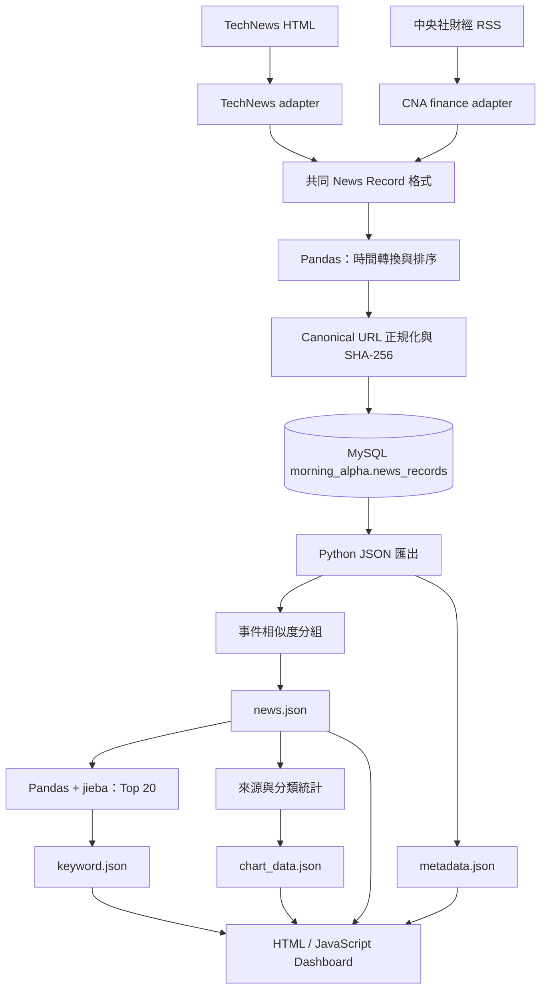

# Morning Alpha v0.1 使用手冊

本手冊依照目前 repository 的實際程式碼撰寫。它不把未來規劃當成已完成功能；若你的 MySQL 是舊版 schema，也會明確標示需要另外執行的升級步驟。

## 1. 專案概覽

Morning Alpha v0.1 是一個繁體中文科技與財經新聞分析學習專案。使用者執行一次 Pipeline，就可以：

1. 從 TechNews 網頁與中央社財經 RSS 收集文章。
2. 把不同來源轉成相同資料格式。
3. 使用 Pandas 整理資料並寫入 MySQL。
4. 以 canonical URL 判斷同一網址，避免重複儲存。
5. 匯出 JSON、計算圖表與中文熱門關鍵字。
6. 在瀏覽器搜尋、篩選、排序及分頁閱讀新聞。
7. 查看被判斷為同一事件的相關文章，同時保留所有來源文章。

它把原本分散的「開新聞網站、複製標題、自己分類、自己計數」變成可重複執行的資料流程。目標使用者是正在學習 Python、資料處理、MySQL 與前端基礎的初學者，或想用端到端專案準備 junior developer／data-related 面試的人。

Morning Alpha 只整理公開新聞標題與連結，不是投資建議，也不會判斷股票應該買或賣。

## 2. 目前功能

| 功能 | 實際行為 | 主要技術 |
| --- | --- | --- |
| 多來源收集 | 解析 TechNews HTML 與中央社財經 RSS | Requests、BeautifulSoup、來源 adapter |
| 共同新聞格式 | 每個 adapter 都產生 `source`、`source_category`、`title`、`publish_time`、`url` | Python dict、資料驗證 |
| HTTP 穩定性 | request 失敗時最多嘗試 3 次，每次相隔 1 秒 | Requests、logging |
| 結構異常偵測 | 必要節點缺失或完全沒有文章時拋出錯誤，Pipeline 停止 | BeautifulSoup、例外處理 |
| Pandas 整理 | 將文章轉成 DataFrame、統一時間型別並由新到舊排序 | Pandas |
| MySQL 儲存 | 建立最新 schema、以 PyMySQL 寫入資料 | MySQL、PyMySQL |
| URL 去重 | 正規化 URL、移除常見追蹤參數，以 SHA-256 hash 的 UNIQUE index 防重 | `urllib.parse`、`hashlib`、MySQL |
| 分類 | 保存來源網站提供的 `source_category`，另以標題規則產生 `analysis_category` | Python |
| 事件分組 | 72 小時內、至少共享 2 個詞且 Jaccard similarity 達 0.35 時分組 | Python、jieba 關鍵字結果 |
| 中文關鍵字 | jieba 斷詞、stop words 過濾，再用 Pandas 計算 Top 20 | `jieba-py`、Pandas |
| JSON 匯出 | 產生新聞、圖表、關鍵字與最後更新時間 | Python `json` |
| Dashboard | 顯示 Chart.js 圖表、新聞連結、搜尋、篩選、排序、分頁與同事件文章 | HTML、CSS、JavaScript、Chart.js |
| Migration 管理 | 預設唯讀檢查 001～004；明確加 `--apply` 才升級既有 schema | Python、SQL |
| 自動測試 | adapters 使用固定 HTML／XML fixtures；其餘功能有單元與 contract tests | `unittest` |

目前沒有使用 DataTables。新聞 table 的搜尋、篩選、排序與分頁都是原生 JavaScript 實作。

## 3. 系統工作流程



關鍵觀念：

- MySQL 是累積保存資料的主要位置；JSON 是提供靜態 Dashboard 使用的輸出格式。
- Dashboard 不直接連 MySQL，也沒有 Python web backend。
- canonical URL 只阻止相同標準網址重複。相同標題可以保存，避免不同來源或更新文章被錯刪。
- 事件分組只增加 `event_group_id` 與 `event_group_size`，不會刪除任何文章。
- `source_category` 是來源網站的分類；`analysis_category` 是 Morning Alpha 依標題規則推論的分類，兩者用途不同。

## 4. 專案結構

以下省略 runtime 產生的 `__pycache__`：

```text
Morning-Alpha/
├── README.md
├── requirements.txt
├── docs/
│   └── USER_GUIDE.md
├── src/
│   ├── run_pipeline.py
│   ├── run_migrations.py
│   ├── news_sources.py
│   ├── news_record.py
│   ├── technews_adapter.py
│   ├── cna_finance_adapter.py
│   ├── crawler.py
│   ├── http_client.py
│   ├── logging_config.py
│   ├── analyze_news.py
│   ├── store_news.py
│   ├── read_news.py
│   ├── url_normalizer.py
│   ├── canonical_url_hash.py
│   ├── backfill_canonical_urls.py
│   ├── news_category.py
│   ├── export_news_json.py
│   ├── event_grouping.py
│   ├── generate_chart_data.py
│   └── analyze_keywords.py
├── sql/
│   ├── 001_add_news_quality_fields.sql
│   ├── 002_add_canonical_url_hash.sql
│   ├── 003_enforce_canonical_url_uniqueness.sql
│   └── 004_remove_title_unique.sql
├── data/
│   ├── raw/
│   │   └── jieba_user_dictionary.txt
│   └── processed/
│       ├── morning_alpha.log                 # 執行後產生
│       └── canonical_url_backfill_report.json # 稽核時產生
├── dashboard/
│   ├── index.html
│   ├── styles.css
│   ├── app.js
│   ├── news.json
│   ├── chart_data.json
│   ├── keyword.json
│   └── metadata.json                         # Pipeline 執行後產生
└── tests/
    ├── fixtures/
    │   ├── technews_homepage.html
    │   └── cna_finance.xml
    └── test_*.py
```

### 重要檔案

| 檔案 | 何時執行／用途 | 互動對象 |
| --- | --- | --- |
| `src/run_pipeline.py` | 日常更新的唯一主要入口，依序執行四個 stages | 所有來源、MySQL、JSON 分析模組 |
| `src/news_sources.py` | 集中註冊並合併目前啟用的 adapters | TechNews、CNA adapters |
| `src/news_record.py` | 定義並驗證跨來源共同格式 | 所有 adapters |
| `src/technews_adapter.py` | 下載與解析 TechNews 首頁，最多 5 篇 | `http_client.py`、BeautifulSoup |
| `src/cna_finance_adapter.py` | 下載與解析中央社產經證券 RSS | `http_client.py`、BeautifulSoup |
| `src/crawler.py` | 為舊入口保留相容性；目前轉呼叫 TechNews adapter | `technews_adapter.py` |
| `src/http_client.py` | 共用 request timeout、retry 與 log | Requests、兩個 adapters |
| `src/logging_config.py` | Pipeline 開始時設定 log 檔 | `data/processed/morning_alpha.log` |
| `src/analyze_news.py` | 建 DataFrame、轉換發布時間、排序 | Pandas、`news_sources.py` |
| `src/store_news.py` | 建立最新 table、準備 canonical URL/hash、寫入 | Pandas、PyMySQL、MySQL |
| `src/read_news.py` | 從 MySQL 讀出全部新聞；單獨執行時顯示最新 20 筆 | MySQL、Pandas |
| `src/url_normalizer.py` | 正規化 scheme/host/path/query，移除常見 tracking parameters | `store_news.py`、backfill |
| `src/canonical_url_hash.py` | 對 canonical URL 建立 64 字元 SHA-256 | `store_news.py`、backfill |
| `src/backfill_canonical_urls.py` | 稽核舊資料；`--apply` 才回填 canonical 欄位 | migration runner、MySQL、稽核 JSON |
| `src/run_migrations.py` | 檢查或套用 001～004 migrations | `sql/`、backfill、MySQL |
| `src/news_category.py` | 依標題關鍵字產生分析分類 | `store_news.py` |
| `src/export_news_json.py` | 將 MySQL DataFrame 轉成前端格式與 metadata | `news.json`、`metadata.json` |
| `src/event_grouping.py` | 在匯出的 records 加入事件群組欄位 | `run_pipeline.py`、`export_news_json.py` |
| `src/generate_chart_data.py` | 統計來源與分類；仍輸出相容的 keywords group | `news.json`、`chart_data.json` |
| `src/analyze_keywords.py` | jieba 斷詞與 Pandas Top 20 計數 | 自訂詞典、`news.json`、`keyword.json` |
| `dashboard/index.html` | Dashboard 語意結構、filters、table、canvas | CSS、JavaScript、Chart.js CDN |
| `dashboard/styles.css` | 桌面與窄螢幕樣式 | `index.html` |
| `dashboard/app.js` | fetch 四個 JSON、繪圖、列表互動與錯誤提示 | JSON、Chart.js |
| `tests/fixtures/*` | 固定的網站輸入，讓 parser tests 可重複 | adapter tests |

## 5. 系統需求

| 項目 | 實際要求 |
| --- | --- |
| Python | `jieba-py==0.46.12` 要求 Python 3.10 以上；repository 未另外鎖定 patch version |
| MySQL | 版本未在程式鎖定；README 安裝範例使用 Homebrew MySQL 8.4 |
| Browser | 支援 JavaScript、`fetch()`、canvas 的現代瀏覽器 |
| 網路 | Pipeline 需連到兩個新聞來源；Dashboard 需連到 jsDelivr 載入 Chart.js 4.5.1 |
| Git | 用於 clone、commit 與 tag；未指定最低版本 |

`requirements.txt`：

```text
requests
beautifulsoup4
pandas
PyMySQL
jieba-py==0.46.12
```

只有 `jieba-py` 固定版本；其他 packages 會安裝當時相容的最新版，因此不同電腦可能有版本差異。

MySQL 設定由 shell environment 讀取，專案沒有 `.env` loader 或設定檔：

| 變數 | 必要 | 預設 |
| --- | --- | --- |
| `MYSQL_USER` | 是 | 無 |
| `MYSQL_PASSWORD` | 是 | 無 |
| `MYSQL_HOST` | 否 | `localhost` |
| `MYSQL_PORT` | 否 | `3306` |
| `MYSQL_DATABASE` | 否 | `morning_alpha` |

## 6. 安裝

以下以 macOS、zsh 與 Homebrew 為例。

### Step 1：Clone

```bash
git clone https://github.com/OllieHu12304/Morning-Alpha.git
cd Morning-Alpha
```

之後所有專案命令都應在含有 `src/`、`dashboard/` 的 repository 根目錄執行。

### Step 2：建立 Python environment

```bash
python3 -m venv .venv
source .venv/bin/activate
python -m pip install --upgrade pip
python -m pip install -r requirements.txt
```

確認 interpreter：

```bash
which python
python --version
```

`which python` 應指向專案的 `.venv/bin/python`。即使 prompt 同時顯示 `(base)`，明確使用 `./.venv/bin/python` 也能避免誤用 `/opt/anaconda3/bin/python`。

### Step 3：安裝 MySQL

```bash
brew install mysql@8.4
export PATH="/opt/homebrew/opt/mysql@8.4/bin:$PATH"
brew services start mysql@8.4
mysql --version
```

若 `zsh: command not found: mysql`，通常是 `mysql@8.4` 的 `bin` 不在 PATH；可以使用上方 `export PATH`，或直接呼叫 `/opt/homebrew/opt/mysql@8.4/bin/mysql`。

### Step 4：建立 database 與帳號

```bash
mysql -u root -p
```

```sql
CREATE DATABASE IF NOT EXISTS morning_alpha
CHARACTER SET utf8mb4
COLLATE utf8mb4_unicode_ci;

CREATE USER 'morning_alpha_app'@'localhost'
IDENTIFIED BY '請替換成安全密碼';

GRANT CREATE, INSERT, SELECT
ON morning_alpha.*
TO 'morning_alpha_app'@'localhost';
```

`morning_alpha_app` 是日常 Pipeline 帳號。不要把 root 或 app password 寫入 Git。

### Step 5：設定連線值

```bash
export MYSQL_USER="morning_alpha_app"
read -s "MYSQL_PASSWORD?MySQL app password: "
echo
export MYSQL_PASSWORD
```

需要非預設值時才設定：

```bash
export MYSQL_HOST="localhost"
export MYSQL_PORT="3306"
export MYSQL_DATABASE="morning_alpha"
```

環境變數屬於目前 shell；新 terminal 不會自動繼承。

### Step 6：處理 schema

全新 database：不需要執行 SQL，第一次 Pipeline 會建立最新 `news_records`。

既有 database：先備份並檢查 migrations。

```bash
mysqldump -u root -p morning_alpha > ../morning_alpha_before_upgrade.sql
python src/run_migrations.py
```

`run_migrations.py` 預設只讀。套用 migrations 需要管理權限：

```bash
export MYSQL_USER="root"
read -s "MYSQL_PASSWORD?MySQL root password: "
echo
export MYSQL_PASSWORD
python src/run_migrations.py --apply
```

它會按照 001 → 002 → canonical URL 稽核／backfill → 003 → 004 執行，已完成的步驟會跳過。若偵測到部分欄位、無效 URL 或 canonical URL 衝突，會停止要求人工檢查。

MySQL DDL 通常會自動 commit，所以 migration 不是完整可 rollback transaction；這也是執行前必須備份的原因。

完成後重新設定 app credentials：

```bash
export MYSQL_USER="morning_alpha_app"
read -s "MYSQL_PASSWORD?MySQL app password: "
echo
export MYSQL_PASSWORD
```

## 7. 如何執行 Morning Alpha

### 正常更新的精確順序

#### Step 1：啟動 MySQL 與 Python environment

```bash
brew services start mysql@8.4
source .venv/bin/activate
```

確認同一個 terminal 已設定 `MYSQL_USER`、`MYSQL_PASSWORD`。

#### Step 2：執行唯一主要入口

```bash
python src/run_pipeline.py
```

四個 stages：

1. `fetch_all_articles()` 依序執行 TechNews 與 CNA adapters；Requests 下載、BeautifulSoup 解析、Pandas 轉時間與排序，最後寫入 MySQL。
2. 從 MySQL 讀取全部新聞，整理前端欄位、執行事件分組，輸出 `news.json` 與 `metadata.json`。
3. 從 `news.json` 統計來源與分析分類，輸出 `chart_data.json`。
4. 從 `news.json` 以 jieba 斷詞、Pandas `groupby` 計數，輸出 Top 20 `keyword.json`。

任何 stage 失敗，後續 stages 不會繼續，避免 Dashboard 混用一部分新、一部分舊的輸出。

#### Step 3：啟動靜態 web server

在第二個 terminal、repository 根目錄執行：

```bash
python -m http.server 8000 --directory dashboard
```

瀏覽 [http://localhost:8000](http://localhost:8000)。停止 server 可按 `Control+C`。

`python src/...` 的意思是「使用目前 Python interpreter 執行 `src` 資料夾中的該檔案」。`src` 不是特殊 Python 指令，只是本專案放原始碼的資料夾名稱。

### 可獨立執行的除錯入口

```bash
python src/technews_adapter.py     # 只檢查 TechNews
python src/cna_finance_adapter.py  # 只檢查 CNA RSS
python src/analyze_news.py         # 觀察共同 DataFrame
python src/read_news.py            # 顯示 MySQL 最新 20 筆
python src/export_news_json.py      # 只重匯新聞與 metadata
python src/generate_chart_data.py   # 只重算 chart_data.json
python src/analyze_keywords.py      # 只重算 keyword.json
```

正常更新仍建議執行 Pipeline，否則各 JSON 可能來自不同時間點。

## 8. 預期結果

### Pipeline terminal

以下只是格式範例，數字取決於來源與 database：

```text
Step 1/4：爬取、整理並儲存新聞…
Step 2/4：匯出 Dashboard 新聞資料…
Step 3/4：產生 Dashboard 圖表資料…
Step 4/4：產生 Top 20 關鍵字資料…
Morning Alpha 資料更新完成。
MySQL 新增新聞：<本次新增筆數> 筆
news.json 新聞：<資料庫累積筆數> 筆
chart_data.json 統計群組：3 組
keyword.json 關鍵字：<最多 20> 個
```

`MySQL 新增新聞` 可以是 0，代表這次來源文章的 canonical URL 都已存在，不一定是錯誤。

### `news.json`

示意格式（不是實際新聞）：

```json
[
  {
    "source": "cna",
    "source_category": "產經證券",
    "analysis_category": "半導體",
    "title": "範例新聞標題",
    "publish_time": "2026-08-11T08:30:00",
    "url": "https://example.com/news/123",
    "event_group_id": "event-...",
    "event_group_size": 2
  }
]
```

單篇事件的 `event_group_id` 可能是 `null`，`event_group_size` 為 1。

### `keyword.json`

```json
[
  {"keyword": "半導體", "count": 6},
  {"keyword": "人工智慧", "count": 4}
]
```

最多 20 筆。Dashboard 熱門關鍵字圖取前 10 筆顯示。

### Dashboard

頁面應顯示：最後更新時間、來源圖、主題分類圖、熱門關鍵字圖、可點擊新聞列表與控制列。若資料為空，會顯示空資料訊息；若 JSON 無法載入，會在頁面顯示對應檔名與錯誤。

## 9. Database

- Database：`morning_alpha`
- Table：`news_records`
- Engine：InnoDB
- Charset／collation：`utf8mb4`／`utf8mb4_unicode_ci`

### 最新 schema

| Column | Datatype | 用途 |
| --- | --- | --- |
| `id` | `BIGINT UNSIGNED AUTO_INCREMENT` | 主鍵 |
| `source` | `VARCHAR(100) NOT NULL` | 來源代碼，如 `technews`、`cna` |
| `source_category` | `VARCHAR(100) NULL` | 來源官方分類 |
| `analysis_category` | `VARCHAR(100) NULL` | Morning Alpha 規則推論分類 |
| `title` | `VARCHAR(500) NOT NULL` | 新聞標題；不再是 UNIQUE |
| `publish_time` | `DATETIME NOT NULL` | 來源發布時間 |
| `url` | `VARCHAR(1000) NOT NULL` | 原始文章 URL |
| `canonical_url` | `VARCHAR(1000) NOT NULL` | 正規化後、適合比較的 URL |
| `canonical_url_hash` | `CHAR(64) NOT NULL` | canonical URL 的 SHA-256 |
| `created_at` | `TIMESTAMP DEFAULT CURRENT_TIMESTAMP` | 寫入資料庫時間 |

唯一索引：`unique_canonical_url_hash`。同一 canonical URL 不會重複插入；標題重複不會被擋下。

### 實用 SQL

```sql
-- 最新 20 篇
SELECT id, source, analysis_category, title, publish_time, url
FROM news_records
ORDER BY publish_time DESC
LIMIT 20;

-- 總筆數
SELECT COUNT(*) AS total_news
FROM news_records;

-- 各來源筆數
SELECT source, COUNT(*) AS article_count
FROM news_records
GROUP BY source
ORDER BY article_count DESC;

-- 只看中央社
SELECT title, publish_time, url
FROM news_records
WHERE source = 'cna'
ORDER BY publish_time DESC;

-- 各分析分類筆數
SELECT analysis_category, COUNT(*) AS article_count
FROM news_records
GROUP BY analysis_category
ORDER BY article_count DESC;

-- 檢查 canonical hash 是否重複；正常應無結果
SELECT canonical_url_hash, COUNT(*) AS duplicate_count
FROM news_records
GROUP BY canonical_url_hash
HAVING COUNT(*) > 1;
```

## 10. Dashboard 使用方式

- 新聞 table：點標題會在新分頁開啟原始網站。
- 搜尋：比對標題、來源、來源分類及分析分類。
- 來源／分類 filters：可單獨或組合篩選。
- 排序：點 Title、Source、Category、Publish Time 表頭切換方向。
- 分頁：每頁可選 10、20、50 筆，並使用上一頁／下一頁。
- 清除篩選：清空搜尋、filters 與同事件條件。
- 同事件：文章屬於多人事件時，點「查看同事件 N 篇」只顯示同組文章。
- 圖表：來源與分類讀取 `chart_data.json`；熱門關鍵字直接讀取 `keyword.json` 前 10 筆。
- 更新時間：讀取 `metadata.json` 的 timezone-aware ISO timestamp。

Chart.js 從 CDN 載入。JavaScript 即使能讀 JSON，離線時仍可能無法建立圖表。

## 11. 疑難排解

### `ModuleNotFoundError`

原因：使用錯誤 interpreter 或尚未安裝 requirements。

```bash
source .venv/bin/activate
which python
python -m pip install -r requirements.txt
```

### `請先設定 MYSQL_USER 與 MYSQL_PASSWORD`

```bash
export MYSQL_USER="morning_alpha_app"
read -s "MYSQL_PASSWORD?MySQL app password: "
echo
export MYSQL_PASSWORD
```

必須在執行 Pipeline 的同一個 terminal 設定。

### MySQL `(1045) Access denied`

常見原因是帳號、密碼、host 不一致，或執行時其實使用 Anaconda Python。先用 MySQL client 測試相同帳號，再確認：

```bash
./.venv/bin/python src/run_pipeline.py
```

### `Unknown column 'source' in 'field list'`

既有 table 尚未升級。先備份，以管理員 credentials 執行：

```bash
python src/run_migrations.py
python src/run_migrations.py --apply
```

第二行會改 schema，不應使用只有 `CREATE, INSERT, SELECT` 的 app user。

### `zsh: command not found: mysql`

```bash
export PATH="/opt/homebrew/opt/mysql@8.4/bin:$PATH"
```

或使用 `/opt/homebrew/opt/mysql@8.4/bin/mysql` 完整路徑。Python 透過 PyMySQL 連線並不依賴 `mysql` CLI，但建立帳號與人工查詢時 CLI 很方便。

### Crawler 結果為空或網站結構異常

可能是來源改版、RSS 結構改變、被阻擋或網路問題。查看：

```bash
tail -n 100 data/processed/morning_alpha.log
```

Parser 會在沒有可用文章時停止，而不是靜默輸出空資料。fixtures tests 通過只表示已知格式仍可解析，不保證真實網站沒有改版。

### HTTP request failure

程式會自動最多嘗試 3 次，每次等待 1 秒。最終仍失敗時，檢查網路、DNS、來源網站狀態與 log，稍後再執行 Pipeline。

### `Failed to fetch` 或 JSON not found

不要直接雙擊 HTML。從 repository 根目錄啟動：

```bash
python -m http.server 8000 --directory dashboard
```

再開啟 `http://localhost:8000`。若 `metadata.json` 尚不存在，先成功執行一次 Pipeline。

### 工作目錄錯誤

若看到 `can't open file 'src/...'`，先用 `pwd` 與 `ls` 確認目前目錄含有 `src`、`dashboard`、`requirements.txt`。

### Dashboard 顯示舊資料

Pipeline 的 JSON 是累積 MySQL 資料的快照。先確認 Pipeline 完整跑完，再重新載入頁面。`fetch()` 已使用 `cache: no-store`，一般不需清 browser cache。

## 12. 目前限制

- 只有 TechNews 與中央社財經兩個來源；TechNews 每次最多抓首頁 5 篇。
- 來源網站 selector 或 RSS 格式改版時，adapter 仍需人工維護。
- adapters 依序執行；任一來源最終失敗會停止整條 Pipeline，尚未支援「部分來源成功」。
- URL 去重只能可靠識別相同 canonical URL。不同平台重新刊登同一事件不會被刪除。
- 事件分組是標題詞彙、時間窗與固定 threshold 的規則式近似，可能漏分或錯分；沒有語意 embedding 或人工確認介面。
- `analysis_category` 是固定規則，不是來源官方分類，也不是機器學習模型。
- jieba 斷詞與 stop words 仍需依新聞資料持續調整；專有名詞可能切錯。
- 沒有文章全文、情緒分析、AI 摘要、股票價格、報酬率或投資建議。
- 沒有後端 API、使用者帳號、權限管理或雲端部署。
- 沒有自動排程或即時更新；使用者必須手動執行 Pipeline。
- Dashboard 每次將全部新聞 JSON 載入瀏覽器；資料量很大時不適合。
- Chart.js 使用外部 CDN，完全離線時圖表不可用。
- requirements 除 jieba 外未鎖版，重建環境可能取得較新 package。
- migration runner 只支援 repository 目前受控的簡單 SQL；DDL 不能保證 rollback。

## 13. 短期 Roadmap

- v0.2：加入排程、單一來源失敗隔離、來源健康狀態與更完整 logging。
- v0.3：改善分類與事件語意相似度，加入人工校正資料。
- v0.4：建立後端 API、server-side pagination 與全文／市場資料整合。
- v1.0：部署、監控、帳號權限、可靠資料管線與可驗證的投資研究工作流。

Roadmap 是建議，不代表已完成。

## 14. 技術學習與面試說明

### Python basics

你可以說明函式如何拆分責任、list/dict 如何表示資料、例外如何讓 Pipeline 在錯誤時停止，以及 `pathlib.Path` 如何建立跨平台路徑。

### Requests

你實作了 timeout、HTTP status 檢查、最多三次 retry 與 request logging。重點不是「能下載頁面」，而是外部服務不可靠時如何明確失敗。

### BeautifulSoup

兩個 adapters 都把 HTML／XML 轉成結構化欄位。fixtures tests 展示 parser 可以不依賴真實網路獨立測試。

### Pandas

DataFrame 用於時間型別轉換、排序、缺值處理，以及 `groupby`／`agg` 關鍵字計數。Pandas 適合表格式轉換與統計；網路下載、資料庫 transaction 和網頁互動則交給其他工具。

### MySQL 與 PyMySQL

MySQL 保存跨次執行的累積資料；PyMySQL 負責 parameterized SQL、連線、commit、rollback。UNIQUE canonical hash 將資料完整性放在 database 層保證，而不只依賴 Python 記憶體。

### HTML、CSS、JavaScript

HTML 定義可存取的控制元件與 table，CSS 負責 responsive layout，JavaScript 用 `fetch()` 載入 JSON 並管理搜尋、filter、sort、page 與事件狀態。

### Chart.js

Chart.js 把 Python 產生的 labels/counts 畫成來源、分類與關鍵字圖表。資料計算留在 Python，瀏覽器主要負責呈現。

### Git

每個 feature 使用獨立 commit，可以清楚說明需求、測試與變更範圍。Migration 檔也讓 database schema 變更具有順序與歷史，而不是只修改最終 DDL。

### 一段面試版總結

> Morning Alpha 是我做的 Python 到前端端到端資料專案。我用來源 adapters 收集 HTML 與 RSS，透過 Pandas 統一資料，用 MySQL 和 canonical URL UNIQUE index 管理累積與去重，再輸出 JSON 給原生 JavaScript 與 Chart.js Dashboard。專案也包含 retry、logging、schema migrations、固定 crawler fixtures、中文斷詞與保留原文的事件分組。我能說明每一層為何使用不同工具，也知道目前規則式分類、來源數量與靜態 JSON 架構的限制。

## 驗證與版本管理

執行全部 tests：

```bash
python -m unittest discover -s tests -v
```

建議在 migration、Pipeline 與 Dashboard 都由你本機驗證後，再建立 release tag。文件本身建議 commit：

```text
docs: update guide for data quality upgrade
```
