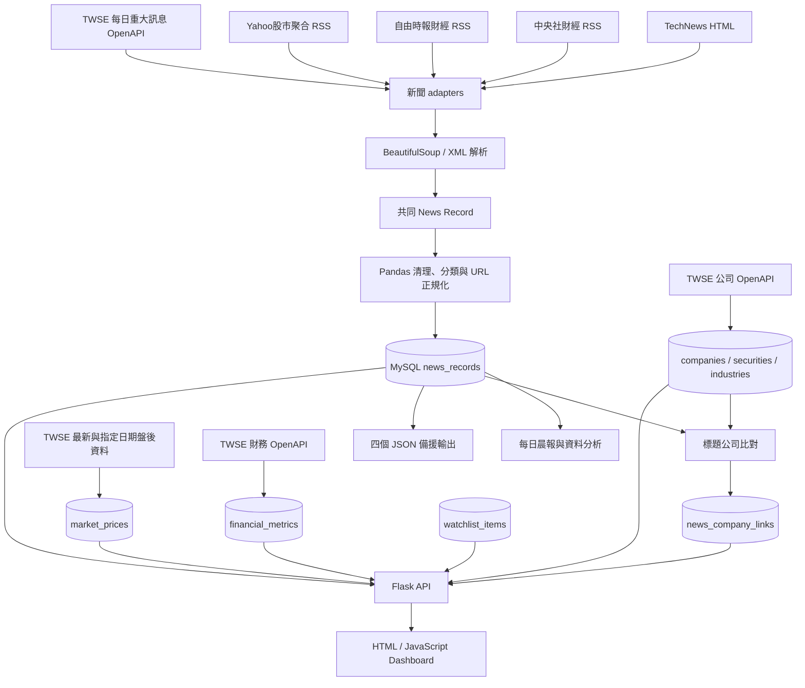

# Morning Alpha 使用手冊

本手冊只描述 repository 在 `v0.3.2` 實際完成的功能。Morning Alpha 使用本機 Python virtual environment 與 MySQL 安裝、執行、學習及展示，但尚未達到可直接公開營運的投資產品等級。

## 1. 專案概覽

Morning Alpha 解決的問題是：科技與財經資訊分散在不同來源，而且新聞、公司、股票資料和市場變化不容易一起閱讀。

使用者執行一個 Pipeline 後，可以在 Dashboard 完成以下任務：

1. 集中閱讀 TechNews、中央社財經、自由時報財經、Yahoo股市聚合 RSS 與 TWSE 官方重大訊息。
2. 搜尋、排序、分頁，並依來源、分類、公司及同事件篩選。
3. 查看來源、分類、中文關鍵字、來源健康與 Pipeline 歷史。
4. 閱讀每日 07:00（Asia/Taipei）固定時間窗的規則式晨報。
5. 查看新聞標題辨識出的 TWSE 公司、產業與股票代號。
6. 查看 TWSE 每日盤後價格、近期缺漏交易日回補及季度財務摘要。
7. 觀察新聞前後交易日價格變化，但不把時間關聯說成因果。
8. 建立本機公司追蹤清單，閱讀個人化追蹤晨報。

預期使用者是正在學習 Python、資料處理、MySQL 與前端整合的初學者，或需要快速整理繁體中文科技／財經資訊的本機使用者。

## 2. 目前功能

| 功能 | 實際內容 | 主要技術 |
| --- | --- | --- |
| 多來源資訊 | TechNews 首頁文章；中央社、自由時報與 Yahoo股市 RSS；TWSE 上市公司每日重大訊息 | Requests、BeautifulSoup、XML／JSON parser |
| 平衡近期樣本 | MySQL 保存全部文章；Dashboard 按每個取得來源採用最新 60 篇 | Pandas |
| 共同資料格式 | adapter 轉成相同 News Record，再交給 Pandas | Python、Pandas |
| 新聞身分與去重 | 分開保存取得來源、原始發布媒體與來源文章 ID；canonical URL 與 `source + source_article_id` 使用 UNIQUE index | Python、MySQL |
| 分類與事件分組 | 標題規則分類；72 小時內用共同關鍵字與 Jaccard similarity 分組 | Python |
| 中文關鍵字 | `jieba-py` 斷詞、Pandas 統計 Top 20 | jieba、Pandas |
| 公司資料 | TWSE 上市公司、產業、股票代號及別名 | TWSE OpenAPI、MySQL |
| 公司辨識 | 以公司名、簡稱、ticker 與 alias 比對新聞標題 | Python 規則式 matching |
| 市場價格 | TWSE 上市個股最新盤後價格，並回補最近 14 個日曆日範圍內缺少的平日資料 | TWSE 官方 JSON、PyMySQL |
| 財務摘要 | TWSE 上市公司季度 EPS、營收、利益與淨利 | TWSE OpenAPI、PyMySQL |
| 每日晨報 | 固定時間窗內的來源、分類、關鍵字與最多 5 篇 highlights | Python、MySQL JSON |
| 事件市場觀察 | 找新聞前後可用交易日收盤價並計算變化；不足時顯示公司關聯或交易日缺口 | Python、MySQL；標示非因果 |
| 追蹤清單 | 本機單一使用者加入／移除公司 | Flask POST/DELETE、MySQL |
| 個人化晨報 | 只計入追蹤公司且公司比對成功的新聞 | Flask、Python |
| Dashboard | 新聞、圖表、晨報、公司資料、追蹤清單與狀態 | HTML、CSS、JavaScript、Chart.js |
| 自動化與測試 | 本機 Python scheduler、GitHub Actions、unit／integration／Playwright tests | Python、GitHub Actions |

Dashboard 沒有使用 DataTables。搜尋、篩選、排序及分頁都是原生 JavaScript。

## 3. 系統工作流程



關鍵觀念：MySQL 是目前 Dashboard 的正式資料來源；`news.json`、`chart_data.json`、`keyword.json`、`metadata.json` 仍由 Pipeline 產生，但主要用於學習、檢查與備援。

新聞的 `source` 是 Morning Alpha 取得資料的 adapter／管道，`publisher` 通常是原始發布媒體。Yahoo股市正式 RSS 沒有提供原始 publisher，因此保存為 `source=yahoo_tw_finance`、`publisher=Yahoo股市`，不使用標題猜測媒體。新聞列表顯示 `publisher`；來源比重與每來源 60 篇的平衡規則使用 `source`。

## 4. 專案結構

```text
Morning-Alpha/
├── .github/workflows/ci.yml
├── .env.example
├── requirements.txt
├── package.json
├── playwright.config.js
├── start.py
├── dashboard/
│   ├── index.html
│   ├── styles.css
│   └── app.js
├── data/
│   ├── raw/
│   └── processed/
├── docs/
│   ├── DATA_SOURCES.md
│   ├── PROJECT_HISTORY.md
│   └── USER_GUIDE.md
├── sql/
│   └── 001 ... 013 migrations
├── src/
│   ├── run_pipeline.py
│   ├── pipeline_process.py
│   ├── api.py
│   ├── scheduler.py
│   ├── run_migrations.py
│   ├── technews_adapter.py
│   ├── cna_finance_adapter.py
│   ├── ltn_business_adapter.py
│   ├── yahoo_finance_adapter.py
│   ├── twse_disclosure_adapter.py
│   ├── twse_company_adapter.py
│   ├── twse_market_adapter.py
│   ├── twse_financial_adapter.py
│   ├── *_store.py
│   ├── daily_brief.py
│   ├── personalized_brief.py
│   ├── company_matching.py
│   ├── news_company_links.py
│   ├── event_market_analysis.py
│   └── watchlist.py
└── tests/
    ├── fixtures/
    ├── dashboard.spec.js
    └── test_*.py
```

重要檔案：

| 檔案 | 何時執行 | 互動對象 |
| --- | --- | --- |
| `start.py` | 日常啟動專案 | `.venv`、`src/api.py`、5050、預設瀏覽器 |
| `src/run_pipeline.py` | 日常更新 | 所有 adapters、Pandas、MySQL stores、JSON exporters |
| `src/pipeline_process.py` | Dashboard 按下更新時 | 使用 API 當下的 Python 環境啟動並追蹤 Pipeline |
| `src/api.py` | 使用 Dashboard 前 | MySQL 與 `dashboard/` |
| `src/scheduler.py` | 選用本機排程 | 使用目前 `.venv` 定期呼叫 `run_pipeline.py` |
| `src/run_migrations.py` | 既有 database 升級前 | `sql/001`～`013` |
| `src/news_sources.py` | Pipeline 第 1 步 | TechNews、中央社、自由時報、Yahoo股市、TWSE 重大訊息 adapters |
| `src/twse_*_adapter.py` | Pipeline 第 2、4、5 步 | TWSE 官方 OpenAPI |
| `src/sync_market_prices.py` | Pipeline 第 4 步 | 最新價格、近期缺漏日期偵測與歷史價格回補 |
| `src/company_matching.py` | Pipeline 第 3 步 | 公司候選資料與新聞標題 |
| `src/daily_brief.py` | Pipeline 第 6 步 | 新聞 records、固定時間窗 |
| `src/watchlist.py` | API 讀寫追蹤清單 | `watchlist_items`、公司資料 |
| `src/personalized_brief.py` | `/api/personalized-brief` | 追蹤清單、公司新聞關聯 |
| `dashboard/app.js` | 瀏覽器載入首頁 | Flask APIs、DOM、Chart.js |
| `docs/DATA_SOURCES.md` | 閱讀來源設計時 | TWSE 欄位契約與限制 |
| `docs/PROJECT_HISTORY.md` | 回顧版本時 | Git commit、設計原因與學習重點 |

## 5. 系統需求

- Python 3.13
- MySQL 8.4
- Git
- 現代瀏覽器
- Node.js 22：只有執行 Playwright tests 需要

`requirements.txt` 已鎖定：Requests 2.34.2、BeautifulSoup 4.15.0、Pandas 3.0.5、PyMySQL 1.2.0、jieba-py 0.46.12、python-dotenv 1.2.2、Flask 3.1.3。Chart.js 是 4.5.1；Playwright 是 1.62.1。

## 6. 安裝

1. Clone、建立 venv、安裝 packages：

```bash
git clone https://github.com/OllieHu12304/Morning-Alpha.git
cd Morning-Alpha
python3 -m venv .venv
source .venv/bin/activate
python -m pip install -r requirements.txt
```

2. 以 MySQL 管理員建立 database 與 app user：

```sql
CREATE DATABASE morning_alpha
CHARACTER SET utf8mb4
COLLATE utf8mb4_unicode_ci;

CREATE USER 'morning_alpha_app'@'localhost'
IDENTIFIED BY '請換成安全密碼';

GRANT CREATE, ALTER, INDEX, REFERENCES, SELECT, INSERT, UPDATE, DELETE
ON morning_alpha.*
TO 'morning_alpha_app'@'localhost';
```

3. 建立 `.env`：

```bash
cp .env.example .env
```

填入剛才實際建立的 app user 密碼。`MYSQL_USER` 與 `MYSQL_PASSWORD` 沒有預設值；其他預設是 `localhost`、port `3306`、database `morning_alpha`。

4. 若是既有 database，先備份再執行 Migration：

```bash
./.venv/bin/python src/run_migrations.py
./.venv/bin/python src/run_migrations.py --apply
```

目前共有 Migration 001～013，最新的 013 為新聞增加 `publisher`、`source_article_id` 與對應 indexes。全新 database 可直接跑 Pipeline；各 store 會建立最新 tables。

## 7. 如何執行 Morning Alpha

請在 repository 根目錄執行：

```bash
python3 start.py
```

啟動器會自動尋找 `.venv`、確認 MySQL 設定、啟動 API、等待 5050 就緒並開啟瀏覽器。按 `Control + C` 可以停止 API；如果 Morning Alpha 已經在 5050 執行，只會開啟現有頁面，不會重複啟動。

### Step 1：啟動 API 與 Dashboard

正常情況不需要再手動執行 `src/api.py`。瀏覽器會開啟 [http://127.0.0.1:5050](http://127.0.0.1:5050)；不要直接雙擊 `dashboard/index.html`，因為頁面需要 Flask API。

### Step 2：更新全部資料

到 Dashboard 的「Pipeline 執行紀錄」區按下「立即更新資料」。九個步驟依序為：

1. 新聞擷取、Pandas 整理、MySQL 寫入。
2. TWSE 公司目錄同步。
3. 新聞標題與公司關聯重建。
4. TWSE 最新盤後價格同步，並回補最近 14 個日曆日範圍內缺少的平日；週末或官方無資料的休市日會略過。
5. TWSE 季度財務摘要同步。
6. 每日晨報產生與保存。
7. 新聞／metadata JSON 匯出。
8. 圖表 JSON 產生。
9. Top 20 關鍵字 JSON 產生。

九步是相依順序：例如先有公司，才能把新聞連到公司；先有股票代號，價格與財務資料才知道要寫到哪家公司。必要步驟失敗時 Pipeline 會停止，後續步驟保持 `pending`，並盡力保存失敗歷史。

### 終端除錯方式

需要查看完整 Pipeline 輸出，或 Dashboard 尚未啟動時，仍可執行：

```bash
./.venv/bin/python src/run_pipeline.py
```

這個按鈕會使用啟動 API 的同一個 `.venv` 與本機 MySQL。終端指令 `./.venv/bin/python src/run_pipeline.py` 仍保留給除錯與觀察完整 log 使用。

### 選用本機排程

若希望在電腦與 MySQL 持續運作時定期更新，可執行：

```bash
./.venv/bin/python src/scheduler.py
```

Scheduler 會先立即執行一次 Pipeline，之後依 `.env` 的 `PIPELINE_INTERVAL_HOURS` 等待下一次執行；預設為 24 小時。按 `Control + C` 可停止。

## 8. 預期結果

下列內容是格式範例，筆數依執行時間與來源內容不同：

```text
Step 1/9：爬取、整理並儲存新聞…
...
Step 9/9：產生 Top 20 關鍵字資料…
Morning Alpha 資料更新完成。
MySQL 新增新聞：[實際筆數] 筆
TWSE 公司資料：[實際筆數] 筆
新聞公司關聯：[實際筆數] 筆
TWSE 最新交易日：[實際日期]
歷史價格回補：[有缺漏時顯示日期]
```

JSON 格式範例：

```json
[
  {
    "source": "cna",
    "analysis_category": "金融市場",
    "title": "[新聞標題範例]",
    "publish_time": "2026-08-11T09:00:00",
    "url": "https://example.com/news"
  }
]
```

```json
[
  {"keyword": "半導體", "count": 4}
]
```

Dashboard 應顯示晨報、追蹤晨報、來源健康、Pipeline 歷史、新聞統計、公司市場資料、事件觀察及新聞列表。若 Event Observation 沒有結果，頁面會區分「沒有公司新聞關聯」、「交易日不足」或「事件附近缺少價格」，而不是偽造結果。

## 9. Database

Database 名稱預設是 `morning_alpha`。以下是目前實際 tables。

### 新聞與執行狀態

| Table | 欄位與 datatype | 用途 |
| --- | --- | --- |
| `news_records` | `id BIGINT`、`source/publisher VARCHAR(100)`、`source_article_id VARCHAR(255)`、`source_category VARCHAR(100)`、`analysis_category VARCHAR(100)`、`title VARCHAR(500)`、`publish_time DATETIME`、`url/canonical_url VARCHAR(1000)`、`canonical_url_hash CHAR(64)`、`created_at TIMESTAMP` | 正式新聞；canonical hash 與 `source + source_article_id` 是 UNIQUE |
| `source_health_events` | `id BIGINT`、`source VARCHAR(100)`、`status VARCHAR(20)`、`article_count INT`、`error_message VARCHAR(500)`、`attempted_at TIMESTAMP` | 每次來源成功／失敗事件 |
| `pipeline_runs` | `id BIGINT`、`status VARCHAR(20)`、`started_at/finished_at DATETIME(6)`、`duration_ms BIGINT`、`failed_step VARCHAR(100)`、`step_results JSON`、`error_message VARCHAR(500)` | 完整九步執行歷史；也能讀舊四步紀錄 |
| `daily_briefs` | `id BIGINT`、`brief_date DATE`、`window_start/window_end DATETIME`、`article_count INT`、`brief_payload JSON`、`created_at/updated_at TIMESTAMP` | 每日一份結構化晨報 |

### 公司與市場資料

| Table | 欄位與 datatype | 用途 |
| --- | --- | --- |
| `industries` | `id BIGINT`、`name VARCHAR(100)`、`created_at TIMESTAMP` | 官方產業名稱 |
| `companies` | `id BIGINT`、`name VARCHAR(200)`、`short_name VARCHAR(100)`、`industry_id BIGINT`、`market VARCHAR(30)`、timestamps | 公司實體 |
| `securities` | `id BIGINT`、`company_id BIGINT`、`ticker VARCHAR(20)`、`exchange VARCHAR(30)`、`currency CHAR(3)`、`is_active BOOLEAN`、timestamps | 公司與上市股票代號 |
| `company_aliases` | `id BIGINT`、`company_id BIGINT`、`alias VARCHAR(200)`、`created_at TIMESTAMP` | 標題比對用別名 |
| `news_company_links` | `id BIGINT`、`news_id/company_id BIGINT`、`matched_text VARCHAR(200)`、`match_method VARCHAR(30)`、`confidence DECIMAL(4,3)`、timestamps | 新聞與公司的規則式關聯 |
| `market_prices` | `id/security_id BIGINT`、`trade_date DATE`、OHLC `DECIMAL(18,4)`、`price_change DECIMAL(18,4)`、`volume BIGINT`、`trade_value DECIMAL(24,2)`、`transaction_count BIGINT`、`source VARCHAR(100)`、`fetched_at DATETIME`、timestamps | 每證券／交易日一筆盤後價格 |
| `financial_metrics` | `id/security_id BIGINT`、`report_date DATE`、`fiscal_year SMALLINT`、`fiscal_quarter TINYINT`、`industry VARCHAR(100)`、EPS `DECIMAL(20,4)`、營收／利益／淨利 `DECIMAL(30,2)`、`currency CHAR(3)`、`source VARCHAR(100)`、`fetched_at DATETIME`、timestamps | 每證券／季度一筆財務摘要 |
| `watchlist_items` | `id BIGINT`、`company_id BIGINT`、`created_at TIMESTAMP` | 本機單一使用者追蹤公司；company id 是 UNIQUE |

常用 SQL：

```sql
SELECT * FROM news_records ORDER BY publish_time DESC LIMIT 20;

SELECT COUNT(*) AS news_count FROM news_records;

SELECT source, COUNT(*) AS news_count
FROM news_records
GROUP BY source
ORDER BY news_count DESC;

SELECT c.short_name, s.ticker, w.created_at
FROM watchlist_items AS w
JOIN companies AS c ON c.id = w.company_id
LEFT JOIN securities AS s ON s.company_id = c.id;

SELECT s.ticker, p.trade_date, p.close_price
FROM market_prices AS p
JOIN securities AS s ON s.id = p.security_id
ORDER BY p.trade_date DESC
LIMIT 20;
```

## 10. Dashboard 使用方式

- 每日晨報：顯示固定時間窗、摘要、來源／分類／關鍵字及 highlights。
- 我的追蹤晨報：可用股票代號、公司名稱或簡稱搜尋並加入公司；追蹤 chips 可直接移除，晨報顯示本期相關新聞。
- 公司市場資料：選公司後顯示最近收盤價、價差、EPS、價格圖與季度 table；按「加入追蹤」或「移除追蹤」管理清單。
- 新聞事件與市場變化：只讀時間關聯觀察；不能當成買賣訊號。空白時會顯示目前公司關聯與價格日期是否足夠。
- 資料來源狀態：「新聞列表篇數」與 Latest News 使用同一份每來源最新 60 篇平衡資料；它不是當次 crawler 原始筆數，也不是 MySQL 累積總數。
- 新聞列表：搜尋標題／來源／分類／公司，使用 select 篩選、點欄位排序及前後頁按鈕。
- 同事件：只有分組成功且多篇的事件才會出現「查看同事件」。文章不會因事件相同而刪除。

## 11. 疑難排解

| 問題 | 原因與處理 |
| --- | --- |
| `ModuleNotFoundError` | 用錯 Python；執行 `./.venv/bin/python -m pip install -r requirements.txt` |
| MySQL `Access denied` | `.env` 帳密與實際 MySQL app user 不一致 |
| `Unknown column`／table 不存在 | 備份後執行 `src/run_migrations.py --apply`，再跑 Pipeline |
| 爬蟲結果空白 | 來源改版、白名單排除或網路失敗；查看 `data/processed/morning_alpha.log` |
| timeout／503 | 外部來源暫時拒絕或太慢；程式最多 retry 3 次 |
| Dashboard `Failed to fetch` | `src/api.py` 未啟動，或直接開啟本機 HTML；使用 port 5050 |
| JSON 找不到 | 從 repository 根目錄跑完整 Pipeline；但 Dashboard 本身使用 API，不依賴 JSON |
| 追蹤清單載入失敗 | 確認 Migration 012 已套用，或重新完成九步 Pipeline |
| Pipeline 在 TWSE 步驟停止 | 市場／財務官方 API 是必要步驟；查看 log，來源恢復後重跑 |
| 股價停在較早交易日 | 查看 Pipeline Step 4 的「TWSE 最新交易日」與 freshness warning；程式會嘗試回補最近 14 個日曆日內的缺漏平日，但不會補齊完整歷史 |
| Event Observation 沒有資料 | 依頁面提示確認 Step 3 是否建立公司關聯，以及 `market_prices` 是否至少有事件附近兩個交易日 |
| 來源狀態數量與 crawler log 不同 | 這是不同口徑：來源卡片以 Latest News 平衡樣本為準；crawler log 顯示當次來源解析量 |

## 12. 目前限制

- TechNews 目前解析首頁所有符合結構的文章，但不會自動翻閱分類頁或回補歷史文章；TWSE 重大訊息是官方公告，不是媒體新聞。
- Yahoo股市 RSS 沒有提供原始 publisher，聚合文章目前統一顯示為 `Yahoo股市`。
- Dashboard 與備援新聞 JSON 每個取得來源最多採用發布時間最新 60 篇；這只限制分析／顯示樣本，不會刪除 MySQL 的完整資料。
- [自由時報官方 RSS](https://service.ltn.com.tw/RSS) 的免費使用限個人或非營利機構網站之非商業用途，並須標示新聞出處；本專案若改為商業用途，必須重新確認授權。
- TWSE 重大訊息目前只保存主旨、公司與發言時間，沒有把完整「說明」欄位寫入資料庫。
- 沒有文章全文、生成式 AI 摘要、情緒分析或投資評分。
- 只有 TWSE 上市範圍；沒有 TPEx、海外股票或即時行情。價格只回補最近 14 個日曆日內的缺漏平日，沒有完整歷史回補。
- 公司辨識、事件分組及分類是規則式推論。
- 不同平台同事件只分組、不刪除；canonical URL 阻止相同正規化網址，`source + source_article_id` 阻止同一取得管道重複匯入相同文章。
- 事件與價格分析沒有控制大盤、產業、財報或其他同時因素，不能推論因果。
- 追蹤清單沒有帳號與多使用者隔離；個人化晨報沒有 email／推播發送。
- API 無 authentication、rate limiting、HTTPS 與 production server。
- 本機 scheduler 需要電腦、本機 MySQL 與 Python 程序持續運作。
- 外部網站或官方 API 改版時，adapter 仍需人工修改。

## 13. v0.3.2 發佈邊界與後續方向

`v0.3.2` 已完成目前四階段範圍，並收斂追蹤晨報、價格新鮮度、缺漏交易日回補、事件觀察診斷及來源計數問題，正式進入功能凍結與維護狀態。接下來不預設增加功能；優先處理實際使用中發現的資料正確性、來源相容性、安全與文件問題。

若未來重新啟動開發，可先評估歷史資料回補、公司辨識準確率量測、合法授權的新增來源，以及 production authentication／部署。這些只是候選方向，不是目前已完成的功能或既定承諾。

## 14. 技術學習與面試摘要

| 技術 | 專案中的證明 | 可說明的觀念 |
| --- | --- | --- |
| Python | adapters、Pipeline、資料驗證、錯誤處理 | 模組、函式、例外、可測試設計 |
| Requests | HTML、RSS、TWSE OpenAPI | timeout、retry、headers、HTTP failure |
| BeautifulSoup | TechNews HTML parser | selector 與網站結構異常 |
| Pandas | News Record 清理、統計、JSON 準備 | DataFrame、缺值、排序、聚合 |
| MySQL | 13 組 migrations 與 12 張業務 tables | schema、UNIQUE、index、foreign key、transaction |
| PyMySQL | parameterized SQL、commit／rollback | 防止 SQL injection 與資料一致性 |
| HTML／CSS | Dashboard 語意結構與 responsive layout | 可讀性、狀態與版面 |
| JavaScript | API fetch、DOM、搜尋、分頁、追蹤清單 | async、狀態管理、輸入驗證 |
| Chart.js | 統計與價格趨勢圖 | 將資料轉成 labels／datasets |
| Flask | MySQL-backed REST-style API 與 static files | 前後端邊界、HTTP methods、safe errors |
| Git | 每個 Feature 對應一個 commit | 小步提交、Migration 與可追蹤歷史 |
| Tests／CI | fixtures、unit、MySQL integration、Playwright、Actions | 測試金字塔與可重現環境 |

面試時可以這樣簡述：

> Morning Alpha 是我完成的端到端本機資料產品。我用 adapters 收集 HTML、RSS 與 TWSE OpenAPI，以 Pandas 統一新聞資料，再用 MySQL 管理 canonical URL 去重、公司關聯、價格、財務、晨報與追蹤清單。Flask API 把資料提供給原生 JavaScript Dashboard，並用 unit tests、MySQL integration、Playwright 與 GitHub Actions 驗證整條流程。我也明確標示規則式分析、非即時資料與非因果觀察的限制。
